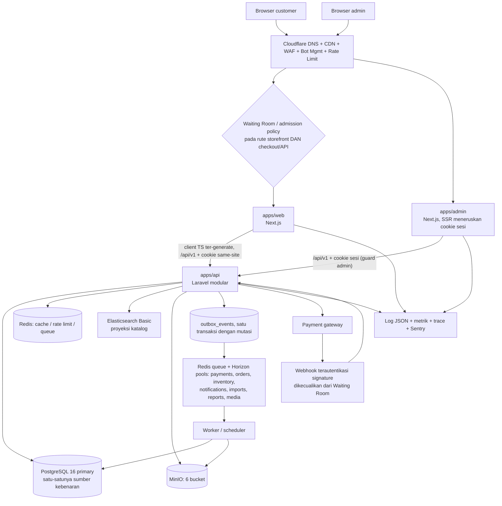

# Dokumen 01 — Arsitektur Platform Elzara

**Rujukan induk:** SNOWEGO_MICROSERVICES_BLUEPRINT.md v1.0 — keputusan di atas mengikuti Blueprint (ADR-003), konflik diselesaikan di Doc 11.

Status: **direvisi mengikuti Blueprint** · Tanggal: 2026-11-16, direvisi 2026-11-17 · Cakupan: topologi, batas modul, kontrak API, model status, uang/stok/konkurensi, edge & object storage, keamanan, Docker/infra, observability, testing, risiko.
Aturan baca: dokumen ini **turunan** (ADR-003 K-1). Semua konflik dengan versi sebelumnya sudah diputus di **Doc 11**; di sini kami hanya menunjuk butirnya (`B-1`, `B-5`, …) dan tidak mengulang perdebatannya.

---

## 0. Yang berubah dari versi sebelumnya

| Butir Doc 11 | Isi perubahan | Bagian di dokumen ini |
|---|---|---|
| B-1 | Tiga aplikasi di-deploy mandiri (API + admin Next.js + web Next.js) dalam satu monorepo; Inertia satu-aplikasi dibatalkan | §1.1, §2.1, §2.2, §3.1 |
| B-2 | `/api/v1` + OpenAPI 3.1 jadi sumber kebenaran kontrak; client TS di-generate | §4 (kontraknya di **Doc 12**) |
| B-3 | Dua sumbu status → **empat sumbu** + `orders.order_type` | §5 (nilainya salinan daftar kanonik Doc 11 §8.3; pemilik nilai final = CHECK Doc 09) |
| B-4 | Nama `Procurement` dikembalikan ke makna supplier; jalur beli-atas-nama jadi modul `MarketplacePurchase` | §3.3, §3.4 |
| B-5 | `stock_items` baris agregat sebagai pemegang kebenaran stok + ledger `stock_movements` | §6.2 |
| B-6 | Konkurensi naik status dari catatan kaki menjadi **spesifikasi** (conditional UPDATE, urutan lock, retry, `paid_stock_exception`) | §6.3–§6.6 |
| B-7 | `Idempotency-Key` di level API + tabel `idempotency_keys`, `inbox_events`, `webhook_receipts` | §4, §6.4, §8 |
| B-8 | Lapisan admission Cloudflare (CDN/WAF/rate limit/Waiting Room) di topologi | §2.4 |
| B-9 | Enam bucket MinIO + alur presigned PUT → finalize → validasi → scan → signed URL | §9.2 |
| B-10 | RBAC 5 role → **10 role** Blueprint §4 | §9.1 (rekonsiliasi "8 tanggung jawab Doc 06 §1" vs "5 role di-seed Doc 10 §8" diputus di Doc 11 B-10; celah CMS/moderator = Q-8) |
| B-11 | PHPUnit tetap; ditambah Testcontainers (Postgres nyata), k6, Playwright | §13 |
| B-12 | SLO & metrik dikuantifikasi; 99,9 % = target pasca-stabilisasi, **bukan** gerbang launch | §1.3, §12 |
| B-13 | Uang integer dipertahankan; `NUMERIC(20,4)` ditolak eksplisit; empat kolom snapshot ditambahkan | §6.1 |
| B-14 | `docs/threat-model.md` menjadi deliverable; mekanisme auth diputus pemilik 2026-11-18 (ADR-007 amandemen), persetujuan kontrol sesi oleh pemilik proyek dan klien dikonfirmasi pada 2026-11-20. Lokasi artefak tertulis masih terbuka | §9.3, §9.4, §16 |
| B-15 | Kalimat risiko single-node + penolakan klaim HA di mana pun | §11.5, §14 |
| Doc 11 §4.4 A–J | Keputusan pemilik 2026-11-18: satu tabel `users` (`is_operator`/`is_admin`, kolom `kind` lama dihapus), RBAC spatie granular + bypass berjejak audit, Sanctum cookie sesi same-site, dependensi terkunci pada versi registry, Scramble hanya draf spec, `activity_log` bukan pengganti `audit_logs`, `X-Actor-Type` = `web \| admin \| system` | §2.1, §2.6, §3.1, §3.3, §4, §9, §12, §16 |
| — | **Sapuan penyelarasan (Doc 11 §8):** nilai empat sumbu status, nama event outbox, nama antrian Horizon, dan rujukan silang lama (tabel `staff_users`, klaim "pemetaan role di Doc 06 §1") disamakan dengan daftar kanonik lintas dokumen | §3.1, §3.3, §5, §7, §8, §9.1, §10 |
| — | **Tidak berubah:** aturan boundary B1–B6 (§3.2), keputusan skema S-1…S-10 dan aturan migrasi M-1…M-13 (Doc 09 §1 dan Doc 10 §1 — dokumen ini hanya menunjuk), model invoice ADR-002, batas kekayaan intelektual (§15), metode observasi hanya-baca (§1.4) | — |

---

## 1. Konteks & tujuan

Elzara adalah platform e-commerce satu-penjual untuk merchandise impor (pop-culture/fandom), dengan tiga jalur pemenuhan yang berjalan di **satu order engine**:

1. **Ready to Ship (RTS)** — stok sudah di Indonesia, langsung diproses.
2. **Pre-order / Group-order (PO)** — periode batch dibuka/ditutup, bayar deposit lalu pelunasan, kirim setelah barang tiba.
3. **Request Order** — buyer mengajukan permintaan barang, admin menerbitkan kuotasi privat berversi yang hanya terlihat oleh akun tersebut.

Prinsip desain: fungsi setara kategori (bukan salinan), arsitektur orisinal, dan semua aset/konten disediakan klien.

### 1.1 Keputusan topologi (perbaruan B-1)

| Opsi | Isi | Verdict saat ini |
|---|---|---|
| A | Modular monolith Laravel + worker/scheduler terpisah, boundary modul tegas, outbox sejak awal | **Tetap dipilih untuk sisi domain** (ADR-001 masih Accepted; Blueprint §2.1/§2.2 sendiri merekomendasikannya) |
| A′ | Satu API Laravel modular **+ dua aplikasi frontend yang di-deploy mandiri** | **Dipilih** — bentuk final kami (Blueprint §2.1 + §3.1, lewat ADR-003 K-2) |
| B | Microservice-lite 4 service + event bus + saga checkout | Roadmap, dipicu kondisi terukur (§2.5) |
| C | 8–10 service + service mesh + K8s | Ditolak (rasio ops:tim tidak masuk untuk 1–2 dev; Blueprint §2.2 juga menolaknya untuk fase awal) |

Yang berubah dari ADR-001 **hanya** satu hal: satu aplikasi UI (Inertia untuk storefront + admin) dipecah menjadi dua aplikasi Next.js. Alasan yang membuat Opsi A masih benar — 1–2 dev, biaya transaksi terdistribusi menghabiskan 40–60 % kapasitas tim, checkout butuh satu DB transaction — tidak dibatalkan oleh butir Blueprint mana pun.

### 1.2 Non-goals (sengaja di luar cakupan desain ini)

Multi-vendor/payout, mobile app native, gudang multi-lokasi fisik (default MVP satu gudang; keputusan Q-5/ADR-011), ERP akuntansi penuh (`payables`/`expenses`/cash-bank tidak diambil — Doc 11 §4.3), pembayaran online marketplace untuk barang digital, harga dinamis/algoritma re-pricing.

### 1.3 Target non-fungsional

Ditulis sebagai **target yang harus diuji**, bukan jaminan (Blueprint §1):

- **Korektness (gerbang launch, tidak bisa dinegosiasi):** nol oversell pada stok dan kuota batch yang dikendalikan sistem; callback pembayaran idempoten; recovery aman setelah retry/crash; jejak audit untuk setiap mutasi uang dan status.
- **Ketersediaan:** 99,9 % adalah **target pasca-stabilisasi**, bukan gerbang launch (B-12). Gerbang launch kami adalah *bisa dipulihkan*: backup teruji + restore drill + runbook pemulihan manual. Lihat §11.5, §12, §14.
- **Latensi & daya tahan:** p95 latensi checkout, error rate, dan queue lag dipantau sejak Sprint 0 (§12). Angka RPS/kapasitas **ditetapkan dari load test k6**, bukan dari asumsi — dan sampai angka itu ada, tidak ada satu pun bagian dokumen ini yang mengklaim kapasitas tertentu.

### 1.4 Metode observasi (tidak berubah)

Kategori fitur dikumpulkan dari peninjauan **hanya-baca** atas situs referensi memakai akun customer milik pemilik proyek, dan pass struktural tanpa login (Doc 05, Doc 08). Hasilnya adalah daftar kemampuan, bukan salinan. **Fakta Doc 08 tidak diubah** (ADR-003 K-4); yang berubah adalah kesimpulan keputusannya: kami memakai Blueprint sebagai **resep**, bukan melaporkan Blueprint sebagai gambaran situs sumber. Struktur internal situs sumber tidak diverifikasi dan bukan rujukan arsitektur.

---

## 2. Topologi ter-deploy

### 2.1 Tiga aplikasi yang di-deploy mandiri (B-1)

| Aplikasi | Stack | Tanggung jawab | Batas proses |
|---|---|---|---|
| `apps/api` | **PHP 8.4 / Laravel 13 modular**, PostgreSQL 16, Redis, Elasticsearch, MinIO | auth, catalog, cart, orders, inventory, preorder batch, product requests, quotations, procurement, payments, billing, fulfillment, logistics, integrations — **satu-satunya pemilik tulis atas data transaksi** | php-fpm + Horizon worker + scheduler |
| `apps/admin` | **Next.js (App Router) + TypeScript** | UI admin, navigasi role-aware (kosmetik, bukan otorisasi), dashboard operasional; SSR/route handler meneruskan cookie sesi yang sama — bukan BFF pemegang sesi (ADR-007 (BFF/sesi) Bentuk C, §2.6) | Node server terpisah |
| `apps/web` | **Next.js (App Router) + TypeScript** | katalog publik, search, cart, checkout, landing batch PO, pengajuan produk, akun customer | Node server terpisah |

Versi framework mengikuti yang **stable dan masih mendapat dukungan keamanan saat implementasi**; angka di atas adalah baseline yang kami kunci di Sprint 0, bukan komitmen seumur proyek. Kalau saat scaffold versi itu bukan lagi supported, perbarui lewat PR dokumen — jangan diam-diam di `composer.json`.

**Baseline terverifikasi 2026-11-18** (dibaca dari Packagist, bukan ingatan — register mengikat: Doc 11 §4.4 D): `laravel/framework` **13.43.0** (naik dari 13.42.0 yang diukur 2026-11-17; php ^8.3, mendukung 8.4) dan `next` 16.4.6 Active LTS (pengukuran 2026-11-17). `node:22` di §11.2 tetap karena itu basis build image, bukan versi host. Tabel dependensi di bawah adalah salinan register Doc 11 §4.4 D — mengubah angkanya wajib lewat PR dokumen yang membaca registry ulang, bukan diam-diam di `composer.json`.

**Tumpukan dependensi auth/observability/alat (versi registry 2026-11-18, = Doc 11 §4.4 D):**

| Paket | Versi | Catatan yang mengikat |
|---|---|---|
| `laravel/framework` | 13.43.0 | php ^8.3; baseline naik dari 13.42.0 yang diukur 2026-11-17 |
| `laravel/sanctum` | 4.5.0 | sesi cookie (`statefulApi`); PAT tidak dipakai (§9.4) |
| `laravel/horizon` | 5.52.0 | **tidak ada v6** — menulis `^6` berarti constraint yang tidak pernah resolve |
| `laravel/socialite` | 5.33.0 | driver google (bawaan) |
| `socialiteproviders/twitter` | 4.1.2 | OAuth 2.0 untuk X; driver `twitter` bawaan Socialite memakai OAuth 1.0a yang sudah ditinggalkan X, jadi tidak dipakai |
| `spatie/laravel-permission` | 8.5.0 | php ^8.3; bentuk tabel spatie, guard `admin` (§9.1) |
| `spatie/laravel-activitylog` | 5.1.5 | **php ^8.4** — host PHP 8.3 tidak bisa memasang ini; `activity_log` bukan pengganti `audit_logs` (Doc 11 §4.4 F) |
| `spatie/laravel-data` | 4.23.1 | DTO di `Contracts/`, bukan di controller |
| `dedoc/scramble` | 0.13.55 | alat bantu **draf** spec, bukan generator kebenaran (§4 butir 11) |
| `sentry/sentry-laravel` | 4.30.0 | `send_default_pii=false`; scrub PII sebelum kirim (threat-model T-32) |
| `maatwebsite/excel` | 4.0.7 | import/export lewat antrian `imports`/`reports`, bukan sinkron di request |
| `phpunit/phpunit` | 13.4.7 | **php >=8.4.1** |
| `phpstan/phpstan` | 2.3.6 | gerbang lint |
| `deptrac/deptrac` | 4.7.2 | architecture test B1–B6 (§3.2); `qossmic/deptrac` 2.0.4 **abandoned** di registry, jadi bukan paket yang dipasang |

Tiga aturan yang menempel pada tabel ini (Doc 11 §4.4 D, ADR-012 (RBAC/identitas/dependensi) D-5):

- **Redis memakai ekstensi `phpredis`** (sudah dipasang di `apps/api/Dockerfile`), bukan `predis` — satu driver, bukan dua.
- **"Laravel RateLimiter" bukan paket composer.** Ia `Illuminate\Support\Facades\RateLimiter` bawaan framework; menulisnya sebagai dependensi berarti mencari paket yang tidak ada.
- **Instalasi dependensi hanya di container** `php:8.4` / `node:22` (`scripts/gen-lockfiles.sh`). Dua paket di tabel ini menuntut PHP 8.4 sementara host PHP 8.3.30, jadi aturan itu bukan preferensi gaya — ia syarat resolve. `composer require`/`npm install` di host tidak boleh dipakai untuk mengubah lockfile.

Ketiganya punya pipeline build, image, dan rilis sendiri. Satu aplikasi boleh di-deploy ulang tanpa menyentuh dua lainnya.

### 2.2 Yang TIDAK berubah: tiga deployment ≠ microservices domain

Ini catatan penting yang diambil dari Blueprint §2.1 sendiri, dan kami pertahankan apa adanya supaya tidak ada yang salah membaca topologi di atas:

> Tiga deployment tersebut adalah pemisahan service pada **lapisan aplikasi/UI**. Satu Laravel API dengan satu database PostgreSQL **masih merupakan modular monolith di sisi domain**, bukan microservices domain penuh.

Konsekuensi yang kami terima sadar:

- `api` tetap **monolit modular dengan bounded contexts yang tegas** — 16 konteks inti (§3.3, tabel pertama) yang sudah ada sejak ADR-001, ditambah 6 modul hasil delta observasi dan Blueprint (§3.3, tabel kedua). Checkout, reservasi stok, kuota batch, dan invoice tetap terjadi di **satu transaksi SQL lokal**. Tidak ada saga dan tidak ada konsistensi akhirnya di jalur uang pada fase ini.
- Jangan menyebut sistem ini "microservices" di dokumen, proposal, maupun obrolan. Yang benar: *API-first modular monolith dengan dua frontend terpisah.*
- Ekstraksi layanan domain adalah **jalur yang terdokumentasi** (§2.5), bukan keadaan saat ini. ADR-001 tetap **Accepted**; ADR-003 K-2 hanya membatalkan bagian "satu aplikasi UI"-nya.

### 2.3 Diagram



### 2.4 Lapisan admission (B-8)

Urutan pertahanan terhadap lonjakan, dari luar ke dalam — **dan tidak ada satu pun lapisannya yang menjamin korektness stok**:

| Lapisan | Tugas | Batas yang harus jujur ditulis |
|---|---|---|
| Cloudflare CDN | cache aset statis, gambar, response katalog publik yang aman | **Jangan** cache cart, session, checkout, pembayaran, atau data customer |
| Cloudflare WAF + Bot Management | filter trafik abusif, bot, credential stuffing | bukan pengganti validasi server |
| Cloudflare Rate Limiting | batas per endpoint / IP / identitas sesuai risk model | identitas anonim mudah dirotasi; pakai limit per akun untuk mutasi |
| **Cloudflare Waiting Room** | admission control saat demand melebihi kapasitas teruji | **bukan job queue**, **bukan jaminan fairness stok**, dan **hanya berguna kalau dipasang juga di rute checkout/API** |
| Nginx di origin | TLS, pembatas koneksi, rute webhook & health | — |
| Queue worker | pekerjaan async (notifikasi, report, sinkronisasi) | bukan antrean pengunjung |
| PostgreSQL | conditional UPDATE + constraint | **satu-satunya tempat korektness stok/kuota/payment** |

Tiga peringatan Blueprint §10 yang kami tulis ulang sebagai aturan, bukan catatan:

1. **Waiting Room ≠ job queue.** Antrean pengunjung diselesaikan di edge; pekerjaan latar belakang diselesaikan di Horizon. Mencampur keduanya membuat halaman tunggu jadi janji yang tidak bisa ditepati.
2. **Waiting Room ≠ fairness stok.** First-come-first-served atas stok butuh kebijakan order/reservation eksplisit di sisi server (§6.3). Timestamp klien, urutan kedatangan HTTP, atau list Redis sederhana **bukan** bukti fairness.
3. **Waiting Room harus menutup rute checkout dan API**, bukan hanya homepage. Kalau hanya homepage yang dijaga, request API langsung tetap membanjiri origin dan seluruh lapisan admission jadi kosmetik. Pengecualian yang disengaja dan tertulis di config: webhook payment terautentikasi (dijaga dengan verifikasi signature, bukan dengan antrean) dan health probe.

Cakupan rute, ambang, dan kebijakan bypass Waiting Room adalah **ADR-009 (kita)** dan bergantung pada angka load test (Doc 11 §6 Q-4) serta ketersediaan fitur di plan Cloudflare klien (Q-6) — keduanya belum dijawab. Untuk MVP: **Waiting Room tidak diaktifkan**; yang dipasang sejak awal adalah CDN + WAF + rate limiting. Fitur ini masuk Phase 4, bukan Phase 0.

### 2.5 Jalur ekstraksi domain (menggantikan daftar pemicu lama)

Blueprint §2.2 memberi target pemecahan saat skala meningkat, dan urutan yang kami setujui: **Notification → Search → Catalog** lebih dulu. **Inventory / Order / Payment jangan dipecah sebelum event consistency dan failure handling matang** — ini persis alasan ADR-001 memilih modular-first, jadi larangan itu kami adopsi apa adanya.

Pemicu yang membuat kami mulai membahas ekstraksi (salah satu terjadi → buka ADR baru):

1. ≥3 dev aktif dengan konflik deploy;
2. order >50/jam selama 2 minggu berturut-turut;
3. brand/tenant kedua;
4. kebutuhan multi-vendor/payout;
5. satu modul butuh scaling atau bahasa lain.

Langkah per service yang benar-benar dipisah: (a) buktikan modul itu hanya memakai kontraknya sendiri — hapus akses lintas modul yang tersisa; (b) pindahkan tabel ke schema/DB sendiri; (c) ganti dispatch in-proc dengan publisher `outbox_events` → broker; (d) expose Command sebagai HTTP + token/mTLS, konsumen memakai client ter-generate; (e) jalankan mode mono + service paralel dengan flag read-only shadow selama 1 sprint; (f) cut-over + rollback lewat replay outbox. Aturan keras: **tidak ada transaksi SQL lintas service, dan tidak ada service yang query tabel service lain secara langsung.** Setelah `Orders` jadi service terpisah, alur deposit/pelunasan wajib didesain ulang sebagai saga dengan compensating refund — itu konsekuensi, bukan bug.

### 2.6 Edge satu host: pemisah path, cookie same-site, tanpa CORS lintas origin

Edge kita adalah **satu host** dengan pemisahan **path**, bukan pemisahan subdomain (`docker/nginx/dev.conf`, ADR-001): `/api/v1/webhooks/` → API (verifikasi signature, dikecualikan dari admission), `/api/` → API, `/storage/` → presign MinIO, `/admin` → app admin, `/` → app web. Konsekuensi yang mengikat auth (ADR-007 (BFF/sesi) amandemen 2026-11-18, Doc 11 §4.4 C):

- Halaman dan API berada pada **origin yang sama**, jadi cookie sesi adalah **same-site**: `Secure; HttpOnly; SameSite=Lax; Path=/` sudah cukup. **Tidak ada konfigurasi CORS lintas origin dan tidak ada `SameSite=None`** — keduanya tidak dibuat karena tidak ada dua origin yang perlu dijembatani. Menambahkannya berarti membuka permukaan yang tidak ada masalahnya.
- `Path=/` wajib supaya cookie ikut terkirim ke `/api/`; pemisahan admin/storefront dilakukan lewat **nama cookie + guard** (`elzara_admin_session`/`elzara_web_session`, guard `admin`/`web`), bukan lewat path cookie (§9.4).
- Browser memanggil `/api/v1/...` langsung dengan cookie sesi (**Bentuk C**). Route handler/server component Next.js boleh meneruskan cookie yang sama untuk SSR, tetapi **tidak memegang sesi sendiri dan bukan tempat keputusan otorisasi**. Tidak ada lapis BFF wajib untuk alur sensitif, jadi pekerjaan Sprint 1 adalah guard + policy + CSRF, bukan membangun BFF. Pengecualian catalog GET publik lewat CDN tetap berlaku (Blueprint §12).
- Server-to-server (webhook gateway, worker internal) tidak memakai cookie sesi: tanda tangan/HMAC atau jaringan internal (§9.4).
- **Batas yang membuka kembali keputusan ini:** kalau produksi kelak memindahkan admin ke subdomain terpisah (`admin.example.com`), cookie menjadi lintas-site dan ADR-007 (BFF/sesi) **harus dibuka kembali** — pemisahan host adalah perubahan topologi, bukan detail konfigurasi (ADR-007 D-6a).

---

## 3. Struktur repo, batas modul, kepemilikan data

### 3.1 Layout monorepo (B-1)

Satu monorepo untuk tim 1–2 dev, **tiga deploy terpisah**. Pohon di bawah adalah Blueprint §3.1 yang kami sesuaikan dengan nama modul kami:

```text
elzara/
├── apps/
│   ├── api/                 # PHP 8.4 / Laravel 13 modular — PEMILIK DATABASE
│   │   ├── app/Modules/
│   │   │   ├── Identity/             # users, addresses, customer_profiles, user_consents,
│   │   │   │                         #   otp_challenges, user_sessions, roles, permissions,
│   │   │   │                         #   model_has_roles, model_has_permissions, role_has_permissions,
│   │   │   │                         #   role_scopes, user_identities, staff_2fa_secrets
│   │   │   │                         #   (staff_users TIDAK dibuat — Doc 11 §4.3; kolom kind lama
│   │   │   │                         #    diganti is_operator/is_admin — Doc 11 §4.4 A)
│   │   │   ├── Catalog/              # products, product_variants, product_options, product_option_values,
│   │   │   │                         #   variant_option_values, product_collections, categories, brands,
│   │   │   │                         #   collections, price_lists, price_list_entries, product_media
│   │   │   ├── Inventory/            # warehouses, stock_items, stock_reservations, stock_movements,
│   │   │   │                         #   stock_transfers, stocktakes
│   │   │   ├── Cart/                 # carts, cart_items, checkout_sessions, wishlist_items
│   │   │   ├── Orders/               # orders, order_items, order_addresses, order_charges,
│   │   │   │                         #   order_adjustments, order_events, returns, return_items
│   │   │   │                         #   (riwayat = order_events; order_status_history hanya view, Doc 09 §18/S-5)
│   │   │   ├── PreOrder/             # preorder_batches, preorder_batch_items, preorder_enrollments,
│   │   │   │                         #   preorder_allocations, preorder_payment_plans
│   │   │   ├── Sourcing/             # product_requests, sourcing_options, quotations, quotation_versions,
│   │   │   │                         #   quotation_items, quotation_visibility_grants              (B-4)
│   │   │   │                         #   (lampiran = baris media polimorfik milik modul Content, bukan tabel request_attachments — S-3)
│   │   │   ├── Procurement/          # suppliers, purchase_orders, purchase_order_items,
│   │   │   │                         #   supplier_invoices, goods_receipts, goods_receipt_items   (B-4: makna Blueprint)
│   │   │   ├── MarketplacePurchase/  # marketplace_purchases, claim_codes, proof_files (B-4: D5 lama)
│   │   │   ├── Billing/              # invoices, invoice_lines, invoice_allocations, receivables
│   │   │   ├── Payments/             # payment_intents, payment_transactions, payments, payment_ledger,
│   │   │   │                         #   refunds, webhook_receipts, reconciliation_runs, reconciliation_items
│   │   │   ├── Fulfillment/          # courier_services, shipping_tariff_rules, shipping_rates_cache, packages,
│   │   │   │                         #   shipments, shipment_order_items, tracking_lanes, lane_stages,
│   │   │   │                         #   tracking_events, shipment_stage_events      (dulu modul "Shipping")
│   │   │   ├── Logistics/            # forwarders, consolidations, cargo_shipments, cargo_items,
│   │   │   │                         #   customs_charges, landed_cost_allocations
│   │   │   ├── Promotion/            # vouchers, voucher_redemptions, loyalty_entries, loyalty_tiers,
│   │   │   │                         #   drops, drop_items, drop_claims
│   │   │   ├── UGC/                  # reviews, review_media, review_moderation
│   │   │   ├── Notification/         # notification_templates, user_preferences, notification_logs,
│   │   │   │                         #   back_in_stock_subscriptions
│   │   │   ├── Content/              # media, pages, content_blocks, content_block_versions,
│   │   │   │                         #   nav_items, localizations            (media = S-3)
│   │   │   ├── Support/              # tickets, ticket_messages        (dispute = jenis tiket, bukan tabel baru)
│   │   │   ├── Search/               # tanpa tabel: proyeksi Elasticsearch, bukan sumber kebenaran
│   │   │   ├── Reporting/            # tanpa tabel: baca materialized views / read model (Doc 09 §18)
│   │   │   ├── Settings/             # feature_flags, feature_flag_overrides, settings
│   │   │   └── Audit/                # audit_logs, activity_log  (trio reliability = outbox/inbox/idempotency milik app/Platform)
│   │   ├── app/Platform/             # shared kernel LINTAS MODUL: enum empat sumbu, ApiProblem RFC 7807,
│   │   │                             #   state-machine runner, outbox writer + dispatcher tujuh antrian,
│   │   │                             #   Infrastructure/Database/Migrations/ untuk trio reliability (M-1)
│   │   │                             #   Platform bukan modul domain: tidak memuat logika bisnis dan tidak
│   │   │                             #   memegang tabel milik modul (B1 tetap satu penulis per tabel)
│   │   ├── app/ModuleLoader/         # service provider glob M-2 — mendaftarkan path modul, tanpa daftar manual
│   │   ├── database/migrations/      # milik framework saja; migrasi modul ada di dir modul masing-masing (M-1)
│   │   └── tests/{Unit,Feature,Concurrency,Contract}/
│   ├── admin/               # Next.js + TS — dashboard operasional; SSR meneruskan cookie sesi, bukan BFF pemegang sesi (ADR-007)
│   └── web/                 # Next.js + TS — storefront publik
├── packages/
│   ├── api-contracts/                # openapi.yaml + client TS ter-generate  (WAJIB: §4 / Doc 12)
│   ├── shared-types/                 # DTO non-domain-sensitive (format tanggal, bentuk pagination)
│   └── ui/                           # komponen React bersama — rumah design token tiga lapis Sprint 0 (Doc 04, task 0.8); jangan menaruh logika uang di sini
├── docker/                           # compose.yaml + profil dev/staging/prod
│   ├── nginx/                        # edge dev: TLS, rate limit origin, pemisah rute api/admin/webhook, location /storage (presign MinIO)
│   └── profiles/                     # override staging/production (di-render, bukan disalin tangan — task 0.16)
├── scripts/                          # pembungkus perintah yang berulang: compose up per profil, codegen klien TS, cek drift kontrak
├── infrastructure/
│   ├── nginx/                        # edge produksi/staging: konfigurasi yang dirender dari profil yang sama (task 0.16)
│   └── monitoring/                   # Prometheus/Grafana/Loki + aturan alert
├── docs/
│   ├── adr/                          # ADR-001…012 ada; ADR-007 (BFF/sesi) mekanisme diputus 2026-11-18, ADR-012 (RBAC/identitas/dependensi) Accepted; 006/009 diblokir jawaban klien/angka, 005/008/010/011 Accepted (Doc 11 §3; §16 dokumen ini)
│   ├── api/                          # export OpenAPI + contoh payload
│   ├── specs/                        # spec per sub-proyek (sprint-0-fondasi.md)
│   ├── runbooks/                     # 11 skenario wajib (Blueprint §15) → deliverable §12
│   └── threat-model.md               # B-14, wajib ada
├── .qoder/
│   ├── skills/                       # skill agen untuk proyek ini
│   ├── agents/                       # definisi agen pelaksana (pencicil task)
│   └── plans/                        # plan development ter-execute (2026-11-17-sprint-0-fondasi.md ada di sini)
└── .github/workflows/                # lint → unit → integration → security → build → deploy
```

`infrastructure/terraform` dan `infrastructure/kubernetes` sengaja **tidak** dibuat sekarang. Blueprint menyebutnya "optional when justified"; sampai pemicu §2.5 terjadi, menambahnya berarti membayar kompleksitas tanpa membayar masalah yang ada.

**Dua aturan yang menempel pada nama pendek ini** (seperti yang diputuskan saat layout disahkan 2026-11-18): (1) `docker/` berada di root, `infrastructure/` hanya berisi artefak yang dirender untuk produksi (nginx, monitoring) — `terraform`/`kubernetes` tetap masuk `infrastructure/` kalau nanti justified; (2) `apps/api` adalah satu-satunya pemilik database, jadi **tidak ada** `docker/db/` atau skema di luar `apps/api/`. Pohon ini diverifikasi mesin, bukan diklaim: gerbang I (Doc 11 §8.8) menolak kalau direktori nyata dan pohon di bagian ini berbeda.

### 3.2 Aturan boundary — TIDAK BERUBAH

B1–B6 tetap mengikat (Doc 11 §2: Blueprint §2.2/§9 setuju, bahkan lebih ketat soal ownership). Struktur tiap modul tidak berubah:

```
app/Modules/<NamaModul>/
  Domain/           entities, value objects, policies, domain events, exceptions
  Application/      Commands (mutasi) + Queries (baca) = satu-satunya pintu masuk
  Infrastructure/   Eloquent models, migrations, driver-specific code, index sync
  Contracts/        interface publik modul + DTO (dikonsumsi modul lain)
  Tests/            unit + feature + concurrency khusus modul
```

- **B1** Satu tabel hanya ditulis oleh satu modul. Modul lain baca lewat Query/DTO, tidak lewat relasi Eloquent lintas modul.
- **B2** Mutasi hanya lewat Command. Controller/artisan/job semuanya memanggil Command. **Di era API-first ini B2 tetap berlaku dan malah jadi lebih penting:** controller HTTP adalah bungkus tipis (validasi → dispatch Command → mapping hasil ke DTO + problem details). Tidak ada logika bisnis di controller, dan tidak ada jalur "langsung dari browser ke tabel".
- **B3** Event lintas modul hanya membawa ID + timestamp, bukan objek/graph.
- **B4** Event yang efeknya keluar proses (queue, webhook, notifikasi) ditulis ke `outbox_events` dalam transaksi yang sama; dispatcher membacanya setelah commit.
- **B5** Uang dan status hanya berubah lewat aggregate Orders/Billing/Payments, tidak pernah lewat `UPDATE` manual.
- **B6** Tiap modul punya namespace sendiri di migration agar pemisahan skema nanti mekanis.

Penjagaan: architecture test (Deptrac/PHPAT) di CI menolak import antar modul yang tidak lewat `Contracts/`, dan menolak controller yang memakai class `Infrastructure/` milik modul lain.

### 3.3 Modul, tanggung jawab, dan kepemilikan tabel

**Enam belas bounded context inti** (warisan ADR-001; nama tabel sudah mengikuti Doc 11 §4.1/§4.2 — bentuk kolomnya ada di Doc 09):

| Modul | Tanggung jawab | Tabel milik modul ini (= Doc 09 §19, lengkap) | Kontrak publik (contoh) |
|---|---|---|---|
| Identity | akun customer & operator (satu tabel `users`), alamat, login/OTP/2FA, identitas sosial, role & permission, consent, sesi, hapus akun | `users`, `addresses`, `customer_profiles`, `user_consents`, `otp_challenges`, `user_sessions`, `roles`, `permissions`, `model_has_roles`, `model_has_permissions`, `role_has_permissions`, `role_scopes`, `user_identities`, `staff_2fa_secrets` — satu tabel `users` untuk admin dan storefront: `is_operator` gerbang login admin, `is_admin` bypass RBAC admin yang wajib berjejak `audit_logs` (Doc 11 §4.4 A). Kolom populasi lama `kind` dihapus, diganti dua boolean itu; pivot lama `role_user`/`permission_role` diganti bentuk spatie (Doc 11 §4.4 B). **`staff_users` tidak dibuat** karena satu baris `users` + `staff_2fa_secrets` sudah mencakup seluruh kebutuhan staf dan dua tabel untuk satu orang adalah sumber bug "staf yang juga customer" (Doc 11 §4.3, diulang di Doc 09 §20 supaya tidak terbaca sebagai kelalaian). Storefront tidak memakai spatie; otorisasi web = kepemilikan + status akun (§9.1) | `GetCustomerProfile`, `EnsureAddressValid` |
| Catalog | produk, varian/SKU, kategori, brand, koleksi/IP, daftar harga, atribut | `categories`, `brands`, `collections`, `products`, `product_collections`, `product_options`, `product_option_values`, `product_variants`, `variant_option_values`, `product_media`, `price_lists`, `price_list_entries` | `FindProductsQuery`, `GetVariantById`, `ProductDTO` |
| Inventory | **kebenaran stok**, reservasi TTL, pergerakan, transfer, stocktake | `warehouses`, `stock_items`, `stock_movements`, `stock_reservations`, `stock_transfers`, `stocktakes` | `ReserveStock`, `ReleaseReservation`, `CommitStock`, `AvailableToSellQuery` |
| Cart | cart multi-line, snapshot checkout, validasi rule, gabungan RTS+PO | `carts`, `cart_items`, `checkout_sessions`, `wishlist_items` | `CartAggregate`, `ValidateCartCommand`, `OpenCheckoutSession` |
| Orders | agregat order + empat sumbu status, split shipment, pembatalan, refund, riwayat | `orders`, `order_items`, `order_charges`, `order_adjustments`, `order_addresses`, `order_events`, `returns`, `return_items` — riwayat status adalah `order_events` (append-only); `order_status_history` hanyalah view proyeksinya (Doc 09 §18/S-5) dan tidak dibuat sebagai tabel | `PlaceOrder`, `TransitionOrder`, `OrderSummaryDTO` |
| PreOrder | batch, item batch + kuota, enrollment, alokasi, tutup batch idempoten | `preorder_batches`, `preorder_batch_items`, `preorder_enrollments`, `preorder_allocations`, `preorder_payment_plans` | `OpenBatch`, `CloseBatch`, `ReserveBatchQuota` |
| Payments | intent/charge/refund, webhook terverifikasi & idempoten, rekonsiliasi, ledger | `payment_intents`, `payment_transactions`, `payments`, `payment_ledger`, `refunds`, `webhook_receipts`, `reconciliation_runs`, `reconciliation_items` — `refunds` menunjuk order + invoice, pemilik tabelnya Payments (Blueprint §3 menaruh refund di Billing & Payment) | `PaymentProvider`, `ChargeCommand`, `RefundCommand` |
| Fulfillment | picking/packing, label, paket, pengiriman, tracking, exception | `courier_services`, `shipping_tariff_rules`, `shipping_rates_cache`, `packages`, `shipments`, `shipment_order_items`, `tracking_lanes`, `lane_stages`, `tracking_events`, `shipment_stage_events` — `shipments` menunjuk `orders` lewat `order_id`, tetapi pemilik tabelnya Fulfillment sesuai Blueprint §3 (domain service = pemilik data); Orders hanya memegang agregatnya | `ShippingRateProvider`, `TrackingProvider`, `CreateLabel` |
| Promotion | voucher, kampanye, poin & tier, drop terbatas | `vouchers`, `voucher_redemptions`, `loyalty_entries`, `loyalty_tiers`, `drops`, `drop_items`, `drop_claims` | `ApplyPromotion`, `AwardPoints` |
| Notification | email, adapter WA, template, preferensi, log pengiriman | `notification_templates`, `user_preferences`, `notification_logs`, `back_in_stock_subscriptions` | `NotifyEvent`, `NotificationChannel` |
| Content | halaman, blok ber-versi, nav, SEO meta, media polimorfik | `media`, `pages`, `content_blocks`, `content_block_versions`, `nav_items`, `localizations` | `PageBlocksQuery` |
| Search | indeks Elasticsearch Basic, pencarian leksikal, sinonim fandom, facet | — (proyeksi Elasticsearch, bukan sumber kebenaran) | `SearchProductsQuery`, `ReindexCommand` |
| Reporting | laporan penjualan, margin, profitabilitas batch, aging stok | materialized views / read model (§18 Doc 09), tidak ada tabel milik modul ini | `SalesReportQuery` |
| Audit | jejak aksi operator atas mutasi sensitif + riwayat model otomatis | `audit_logs`, `activity_log` — `audit_logs` append-only dengan `reason` wajib, `before`/`after`, `request_id`, ditulis `AuditThis` (S-6); tanpa baris ini aksi berisiko dianggap tidak terjadi. `activity_log` (spatie/laravel-activitylog) adalah riwayat model otomatis dan **tidak memenuhi kewajiban audit** (Doc 11 §4.4 F). Trio reliability `outbox_events`/`inbox_events`/`idempotency_keys` **tidak** dimiliki modul mana pun: dipegang `app/Platform/` (§3.1) dan tercatat sebagai "Lintas modul" di Doc 09 §19 | `AuditThis`, `IdempotencyGuard` |
| Support | tiket, dispute pesanan | `tickets`, `ticket_messages` | `OpenTicket` |
| Settings | konfigurasi, feature flag, kurs & pajak sebagai data referensi | `feature_flags`, `feature_flag_overrides`, `settings` | `SettingValueQuery` |

**Enam modul tambahan** (delta observasi Doc 05/07 + Blueprint; semuanya tunduk pada B1–B6 yang sama — ini modul, bukan service baru):

| Modul | Asal | Tabel milik modul ini (= Doc 09 §19, lengkap) | Kontrak publik |
|---|---|---|---|
| Sourcing | rename + perluasan modul `Quotes` (B-4) | `product_requests`, `sourcing_options`, `quotations`, `quotation_versions`, `quotation_items`, `quotation_visibility_grants` — lampiran blueprint `request_attachments` **tidak dibuat** sebagai tabel kedua: dilayani `media` polimorfik lewat `product_requests.reference_media_id` (S-3, Doc 11 §4.2); prefiks `quotation_*` dipakai konsisten (Doc 09 §20) | `SubmitProductRequest`, `IssueQuotation`, `AcceptQuotation` |
| Procurement | makna dikembalikan ke supplier (B-4) | `suppliers`, `purchase_orders`, `purchase_order_items`, `supplier_invoices`, `goods_receipts`, `goods_receipt_items` | `CreateSupplierPo`, `PostGoodsReceipt` |
| MarketplacePurchase | D5 lama, berganti nama (B-4) | `marketplace_purchases`, `claim_codes`, `proof_files` | `IssueClaimCode`, `RedeemClaimCode` |
| Billing | ADR-002 / D2 | `invoices`, `invoice_lines`, `invoice_allocations`, `receivables` | `IssueInvoice`, `OpenReceivablesQuery` |
| Logistics | Blueprint §4 menu International Logistics + D3 | `forwarders`, `consolidations`, `cargo_shipments`, `cargo_items`, `customs_charges`, `landed_cost_allocations` | `AllocateLandedCost`, `RecordCustomsCharge` |
| UGC | D6 | `reviews`, `review_media`, `review_moderation` | `SubmitReview`, `ModerateReview` |

Kontrak publik lintas modul **hanya** lewat `Contracts/` (interface + DTO). Query lintas modul lewat DB langsung dilarang (B1/S-10); kebutuhan laporan dilayani read model.

**Jumlah tabel tidak ditulis tangan di sini.** Pemilik pemetaan tabel → modul dan jumlah tabel adalah **Doc 09 §19**, diproduksi ulang oleh `verify_schema.py`; kedua tabel di atas dan pohon §3.1 adalah cerminnya (gate H/I, Doc 11 §8.8). Keputusan pemilik 2026-11-18 (Doc 11 §4.4 A–F) mengubah keanggotaan Identity dan Audit — pivot lama diganti bentuk spatie, `user_identities` masuk Identity, `activity_log` masuk Audit — jadi perubahan harus masuk Doc 09 §19 serta Doc 01 §3.1/§3.3 di sini, dan `app/Modules/` di disk sekaligus, atau gerbang gagal.
### 3.4 Delta yang masih berlaku, dan delta yang dibatalkan

Delta observasi D1–D7 dari Doc 05/07/08 **tetap** jadi bagian arsitektur: batch sebagai kelas satu (D1), invoice sebagai entitas terpisah (D2/ADR-002), biaya internasional ditetapkan kemudian (D3 → sekarang punya entitas sendiri di modul Logistics: `customs_charges`, `landed_cost_allocations`), tracking per-lane (D4 → lihat §5.1 dan urutan tahapnya di §5.4 untuk cara ia hidup di tengah empat sumbu), konten/konfigurasi berat + i18n + flags (D6), snapshot alamat & harga (D7 → §6.1).

| Delta | Status | Catatan |
|---|---|---|
| D5 "jalur procurement pihak ketiga" | **Diganti nama menjadi modul `MarketplacePurchase`** (B-4) | Tabrakan nama dengan makna Blueprint. Perilaku dan tabel (`marketplace_purchases`, `claim_codes`, `proof_files`) tidak berubah; masih di balik feature flag dan bisa dimatikan tanpa merusak flow lain. |
| D8 "admin satu-aplikasi, tidak ada API JSON publik" | **Dibatalkan sebagai keputusan, tetap berlaku sebagai bukti** (ADR-003 K-2/K-4) | Fakta Doc 08 §3–§4 (shell admin berbagi chunk dengan halaman customer, satu endpoint klien) tetap benar dan tersimpan. Kesimpulan arsitekturnya diganti: kita **memilih** API publik berversi + dua app, bukan karena situs sumber begitu, tapi karena Blueprint dan karena dua UI perlu bisa rilis terpisah. |

---

## 4. Kontrak API (B-2)

**Keputusan:** `/api/v1` dengan **OpenAPI 3.1 sebagai sumber kebenaran**, dan client TypeScript yang **di-generate** dipakai oleh kedua aplikasi Next.js. Dokumen kontraknya sendiri adalah **Doc 12 — `12-api-contract.md`**; bagian ini hanya menaruh aturan yang mengikat arsitektur, supaya tidak ada dua sumber kebenaran.

Aturan minimum (rincian, contoh payload, dan daftar endpoint: Doc 12):

1. **Satu sumber kebenaran.** `packages/api-contracts/openapi.yaml`. Bentuk payload yang tidak ada di spec tidak boleh dipakai frontend. Gerbang CI: **PR yang mengubah controller/route tanpa mengubah spec gagal.**
2. **Client ter-generate, tidak pernah diedit tangan.** Kalau hasilnya tidak ergonomic, perbaiki spec-nya, bukan output-nya.
3. **`Idempotency-Key` wajib untuk semua mutasi uang/order** — checkout, pembuatan order, payment intent, accept quotation, refund, batch close, adjustment stok, goods receipt. Server menyimpan scope `(actor, operation, key)` + hash request + hasil di `idempotency_keys` (B-7). Key sama + payload sama → hasil yang sama; key sama + payload berbeda → `409`.
4. **Pagination cursor**, bukan offset, untuk semua daftar yang bisa tumbuh melewati satu halaman.
5. **Error = RFC 7807 problem details** dengan skema URN `type` kita sendiri; bukan HTML, bukan array `errors` ad hoc.
6. **`X-Request-Id`** diterima bila dikirim klien, selalu dikembalikan, dan menjadi benang log/trace di ketiga aplikasi.
7. **Re-pricing server-side mutlak.** Harga, diskon, pajak, ongkir, stok, dan kuota **dihitung ulang di server** dari `checkout_sessions` yang tervalidasi. Total dari browser tidak pernah dipercaya dan tidak pernah dibaca.
8. **Versioning.** `/api/v1` tidak menerima breaking change. Breaking = `/api/v2`, dengan v1 dideprecate lewat header `Deprecation` + `Sunset` + catatan di Doc 12. Kebijakan detail: Doc 12 §1.4.
9. Command (B2) tetap satu-satunya pintu mutasi di sisi server. **Menambah endpoint tidak boleh menambah jalur bisnis baru.**
10. Model auth pada endpoint mengikuti **ADR-007 (BFF/sesi) hasil amandemen 2026-11-18** — cookie sesi Sanctum same-site (§2.6, §9.4), bukan bearer token. Larangan lama "belum boleh ada `securitySchemes` sebelum ADR-007 tertutup" **dicabut** (Doc 11 §4.4 I): `openapi.yaml` wajib memuat skema cookie + CSRF dan `security` per operasi, `x-elzara-auth` tetap penanda kategori (`public | customer | admin | s2s`), operasi admin menambah `x-elzara-permission: <modul>.<aksi>`, dan `X-Actor-Type` = `web | admin | system` (sebelumnya `customer | staff | system`) diisi **server** dari guard, tidak pernah dipercaya dari klien. Rincian: Doc 12 §3.1.
11. **Scramble tidak membalik arah kontrak** (Doc 11 §4.4 E). `dedoc/scramble` menghasilkan **draf** spec yang direview manusia lalu digabungkan ke `packages/api-contracts/openapi.yaml`; spec tetap satu-satunya sumber kebenaran dan `scripts/check-contract-drift.sh` tetap menolak PR yang mengubah controller tanpa mengubah spec. Spec **tidak pernah** di-generate ulang secara otomatis di CI.

---

## 5. Model status: empat sumbu (B-3)

Model dua sumbu lama (`money_status` × `fulfillment_status` per lane) **diganti** oleh Blueprint §5.4. Empat sumbu yang berdiri sendiri. Tabel di bawah adalah **peta semantik** yang menyalin nilai kanonik Doc 11 §8.3 apa adanya — dokumen ini tidak boleh menjadi tempat kedua yang menuliskan ulang daftar nilainya:

| Sumbu | Dimiliki modul | Nilai kanonik (= Doc 11 §8.3) | Deviasi dari Blueprint, dengan alasan |
|---|---|---|---|
| `order_status` | Orders | `awaiting_payment · paid · processing · shipped · delivered · completed · on_hold · refund_requested · refund_pending · refunded · disputed · expired · cancelled` | `draft` (Blueprint §5.1) **tidak dipakai**: cart adalah `carts`/`cart_items`, order lahir langsung `awaiting_payment`. `on_hold` dan `refund_requested` ekstensi kita — tahan manual CS/fraud, dan pengajuan retur customer sebelum refund disetujui. |
| `payment_status` | Payments + Billing | `unpaid · partially_paid · paid · overdue · refund_pending · refunded · disputed` | Isi `money_status` lama (hanya berganti nama), ditambah `disputed`: Blueprint §5.1 mendaftar dia sebagai eksepsi, kita sempat menaruhnya sebagai flag saja. |
| `fulfillment_status` | Fulfillment | `unprocessed · reserved · awaiting_batch · at_warehouse · ready_to_ship · picking · packed · handed_over · in_transit · delivered · returned` | `awaiting_batch` dan `ready_to_ship` **dipindah dari `order_status`**, karena keduanya tahap perjalanan barang, bukan status bayar/order (aturan B-3: lane mengisi sumbu fulfillment). `customs` **dihapus** dari sumbu ini — faktunya dijaga `procurement_status`; dua pemilik untuk satu fakta = jejak yang bisa saling bertentangan. |
| `procurement_status` | Procurement + Logistics | `not_required · sourcing · requisitioned · po_issued · supplier_confirmed · in_transit · customs · received · failed` | Blueprint §5.4 menamai sumbunya tapi **tidak** enumerasi nilainya; daftar ini keputusan kita (Doc 02 memakainya sebagai kandidat, Doc 09 memutuskan). `failed` wajib ada karena Blueprint §5.2 butir 8 menjanjikan "completion/refund jika gagal sourcing". `ready_to_ship` keluar (bukan fakta procurement). `requisitioned` = PO berstatus `draft`/`pending_approval`, bukan tabel baru (Doc 11 §4.3). |

**Pemilik nilai final adalah CHECK di Doc 09**; bagian ini hanyalah peta semantik. Artinya: kalau suatu saat keduanya berbeda, **Doc 09 yang menang dan bagian ini yang diperbaiki** — bukan sebaliknya. Nilai di luar daftar ini adalah bug, bukan varian (Doc 11 §8.3).

plus **`orders.order_type = ready_stock | preorder | request_order`** sebagai pembeda jalur di satu order engine, dengan modul khusus (`preorder_enrollments`, `product_requests`, `quotations`) sebagai relasi.

### 5.1 Pemetaan model lama → model baru

Ini yang harus dipahami siapa pun yang membaca dokumen pra-Blueprint:

| Konsep lama | Nasibnya |
|---|---|
| `money_status` | **Diganti nama menjadi `payment_status`**. Nilainya bertahan; namanya hilang dari skema. |
| `awaiting_batch` di `order_status` | **Dipindah ke `fulfillment_status`** (Doc 11 §8.3). Order jalur impor yang barangnya belum masuk batch sekarang terbaca `order_status = paid` + `fulfillment_status = awaiting_batch`, bukan satu status gabungan. |
| `ready_to_ship` di `order_status` | **Dipindah ke `fulfillment_status`.** Sekaligus ditegaskan: ia **tidak** ada di `procurement_status` — barang siap angkat adalah fakta gudang, bukan fakta pembelian. |
| `customs` di `fulfillment_status` | **Dihapus dari sumbu fulfillment**, dan kini hanya hidup di `procurement_status = customs`, karena leg kepabeanan menghasilkan `customs_charges` yang penjaga faktunya ada di sisi procurement/Logistics. |
| `shipped_by_supplier` | **Tidak dipakai.** Nilai kanoniknya `procurement_status = in_transit` (pengiriman supplier adalah pergerakan barang, bukan status unik kita). |
| `pending` | **Bukan nilai kanonik** di sumbu mana pun; padanannya `order_status = awaiting_payment` (atau `payment_status = unpaid`). |
| `disputed` sebagai flag order | Kini **nilai enum** di `payment_status` (dan tetap ada di `order_status` sebagai eksepsi), bukan bendera boolean saja. |
| Lane `rts`, `import_po`, `request`, `procurement` | **Bukan `order_type`.** Keempatnya tetap menjadi **pengisi tahap `fulfillment_status`** (`tracking_lanes`/`lane_stages`, D4): jalur lokal tidak melewati tahap leg luar negeri, jalur impor menambahnya. Yang memetakan ke `order_type` hanyalah tiga jalur transaksi: RTS → `ready_stock`, PO → `preorder`, Request → `request_order`. Lane `procurement` (D5) **tidak** menjadi `order_type` keempat — ia tetap varian pemenuhan + modul `MarketplacePurchase` di balik feature flag. Urutan tahapnya ada di §5.4. |
| `po_batches` / `batch_offers` / `po_lines` | menjadi `preorder_batches` / `preorder_batch_items` / `preorder_enrollments` (Doc 11 §4.1) |
| `quote_requests` / `quotes` / `quote_items` | menjadi `product_requests` / `quotations` / `quotation_items`, ditambah `quotation_versions` (kuotasi **berversi**, §7.3) |
| `parcels` / modul `Shipping` | menjadi `packages` / modul `Fulfillment`; event pengirimannya ikut `PackageShipped` (§8) |
| Label status yang dilihat customer | tetap **turunan** dari keempat sumbu + lane (S-5: kolom turunan tidak boleh ditulis). Bukan sumbu kelima. |

### 5.2 Kenapa empat, dan apa bayarnya

Manfaat: satu order PO bisa simultan `order_status = processing`, `payment_status = partially_paid` (DP lunas, pelunasan belum), `procurement_status = in_transit`, `fulfillment_status = awaiting_batch`. Model dua sumbu harus melahirkan belasan status kombinasi untuk menyatakan hal itu.

Bayaran yang kami terima sadar: (a) setiap transisi perlu guard per sumbu, (b) test matriks transisi jadi wajib (Doc 11 §5: "state machine test per transisi"), (c) label customer harus dipetakan lewat satu fungsi turunan yang teruji, bukan dirangkai di Blade atau di komponen React. Mesin status didefinisikan deklaratif (config per status + guard + action); **setiap transisi menulis riwayat append-only** (`order_events`, diproyeksikan sebagai `order_status_history` — Doc 11 §4.1). Tidak ada transisi yang menghapus jejak; koreksi = transisi balik dengan `reason` wajib.

Pada fondasi Sprint 0, `StateMachineRunner` menyediakan `TransitionSink` opsional. Jika dipasang, sink menerima sumbu, nilai sebelum dan sesudah, serta alasan yang wajib diisi, hanya setelah perubahan status berhasil. Sink memakai koneksi database yang dipilih untuk transisi dan menulis dalam transaksi yang sama. Exception dari sink membatalkan perubahan status. Integrasi produksi Orders/Audit untuk menyimpan riwayat append-only masih menjadi pekerjaan lanjutan.

### 5.3 Diagram jalur

Keempat sumbu berjalan **paralel dan tidak saling meniru**. Yang di bawah ini hanya kepala jalurnya; rantai tahap `fulfillment_status` per lane tidak digambar di sini supaya tidak ada dua daftar untuk satu fakta — lihat §5.4.

```
order_status        : awaiting_payment → paid → processing → shipped → delivered → completed
                      eksepsi: on_hold · refund_requested → refund_pending → refunded
                               disputed · expired · cancelled
payment_status      : unpaid → partially_paid → paid → overdue
                      eksepsi: refund_pending · refunded · disputed
                      (jalur PO: unpaid → partially_paid (DP lunas) → invoice balance → paid)
procurement_status  : tidak berlaku untuk pembelian lokal → not_required
                      jalur impor : sourcing → requisitioned → po_issued → supplier_confirmed
                                    → in_transit → customs → received
                      ujung gagal : failed (jalur impor dan request_order) → refund/realokasi (§6.5)
fulfillment_status  : rantai per lane ada di §5.4; tahap akhirnya delivered, eksepsi returned
```

`product_requests.status` (`submitted → reviewing → sourcing → quoted → accepted → ordered → fulfilled`, §7.3) dan state batch PO (`draft → scheduled → open → closing → closed → purchasing → inbound → received → completed`, §7.2) adalah **status agregat lain**, bukan sumbu kelima dan bukan keenam — order tidak menyimpannya.

Order dengan banyak item boleh menghasilkan **split shipment** dan **split procurement** — satu order, beberapa paket, beberapa PO supplier.

### 5.4 Urutan per lane

`fulfillment_lane` adalah **pemilih tahap**, bukan sumbu kelima (salinan setia Doc 11 §8.3):

- `rts`: `unprocessed → reserved → picking → packed → handed_over → in_transit → delivered (→ returned)`
- `import_po`: `unprocessed → awaiting_batch → at_warehouse → ready_to_ship → picking → packed → handed_over → in_transit → delivered (→ returned)`; tahap luar negeri (`sourcing … customs … received`) **tidak** ditulis di sini, itu milik `procurement_status`.
- `request`: sama dengan `rts` setelah kuotasi diterima; sebelum itu statusnya ada di `product_requests.status` dan `procurement_status`.
- `marketplace_purchase` (D5): jalur pendek `unprocessed → handed_over → in_transit → delivered` karena barang berangkat dari penjual pihak ketiga.

Status yang **dilihat customer** tetap turunan dari keempat sumbu + lane (S-5: kolom turunan tidak ditulis), dihasilkan satu fungsi teruji — bukan dirangkai di Blade atau di komponen React (§5.2).

---

## 6. Uang, stok, dan konkurensi

### 6.1 Model uang (B-13)

**Tetap: integer minor units rupiah.** Semua nominal disimpan sebagai `bigint` rupiah utuh (S-1), berpasangan dengan `currency char(3) DEFAULT 'IDR'`. Persentase/fee dihitung dengan presisi tetap lalu dibulatkan satu arah (half-up), dan selisih pembulatan **ditulis ke ledger**, tidak hilang. Amandemen **ADR-002** tetap berlaku penuh dan tidak disentuh Blueprint: `orders → invoices → payment_intents`, dengan tipe tagihan `deposit | balance | intl_fees | domestic_ship | extra_ship | adjustment`, masing-masing punya jatuh tempo dan reminder sendiri; Blueprint §6 mengenal `invoices` + `invoice_lines` + `receivables` sehingga skema kita **bertambah, tidak diganti** (Doc 11 §2).

**`NUMERIC(20,4)` secara eksplisit ditolak.** Blueprint §6 mengizinkan "integer minor units **atau** `NUMERIC(20,4)` dengan aturan pembulatan eksplisit". Kami memilih satu: **integer**. Alasannya bukan selera — dua representasi uang dalam satu basis data adalah sumber bug pembulatan: `NUMERIC` membawa scale yang harus disamakan di setiap join, aggregate, dan konversi ke satuan driver pembayaran (tiap gateway memakai satuan berbeda), dan satu `::numeric` yang lolos ke laporan menghasilkan selisih yang tidak bisa dijelaskan saat rekonsiliasi. `bigint` cukup sampai Rp9,2 kuadriliun. Kalau nanti muncul kebutuhan satuan fraksional (mis. berat per kg untuk biaya kargo), ia masuk sebagai **kolom ukuran sendiri dengan unit eksplisit**, bukan sebagai nominal uang desimal.

**Empat kolom snapshot ditambahkan (B-13)** pada `orders` dan `quotations` (dan di mana pun dokumen uang diterbitkan), melengkapi S-8 yang sudah ada:

| Kolom | Isi | Kenapa wajib |
|---|---|---|
| `currency_code` | kode ISO yang berlaku saat dokumen terbit | satu basis data menyimpan histori lintas kebijakan |
| `exchange_rate_snapshot` | kurs yang dipakai, dibekukan saat terbit | jalur impor/request menghitung biaya dari kurs luar; kurs hari ini ≠ kurs tagihan |
| `tax_rule_snapshot` | aturan pajak/pajak impor yang berlaku (struktur eksplisit, bukan free-form) | `intl_fees` terbit berbulan-bulan setelah PO dibuka; rumusnya harus bisa dibuktikan ulang |
| `price_snapshot` | harga satuan + diskon + ongkir yang disepakati per baris | re-pricing server (§4 butir 7) harus bisa mereproduksi nominal lama, bukan menebak |

Snapshot, bukan referensi hidup (S-8): edit admin atau perubahan profil **tidak boleh** mengubah dokumen tahun lalu. Kurs dan aturan pajak tetap dikelola sebagai `settings` (S-1…S-10 tidak berubah); kolom snapshot menyimpan **hasil** yang dibekukan, bukan memindahkan kepemilikan datanya. Aturan U1 (integer), U4 (pembayaran gabungan dengan alokasi per invoice) dan U5 (rekonsiliasi harian tanpa auto-adjust) tetap berlaku.

### 6.2 Kebenaran stok (B-5)

Versi lama Doc 09 hanya punya ledger + reservasi. Blueprint §6.1 meminta **baris agregat** sebagai pemegang kebenaran, dan itu diadopsi:

```
stock_items            [Inventory]  — SATU baris agregat per (warehouse_id, sku_id)
  on_hand       integer NOT NULL DEFAULT 0     fisik ada di gudang
  reserved      integer NOT NULL DEFAULT 0     ditahan reservasi aktif
  damaged       integer NOT NULL DEFAULT 0     tidak bisa dijual, tetap dicatat
  in_transit    integer NOT NULL DEFAULT 0     sudah bergerak, belum tiba (bukan available)
  quarantined   integer NOT NULL DEFAULT 0     ditahan menunggu pemeriksaan
  --
  available_to_sell = on_hand − reserved − unavailable     (generated/view, tidak ditulis — S-5)
  unavailable       := damaged + quarantined               (definisi kita; B-5 menuntut nilai ini jelas)
  CONSTRAINTS: on_hand >= 0, reserved >= 0, damaged >= 0, in_transit >= 0,
               quarantined >= 0, available_to_sell >= 0
  UNIQUE (warehouse_id, sku_id)
```

`sku_id` menunjuk `product_variants.id` (rename Doc 11 §4.1), `warehouse_id` menunjuk `warehouses.id`. Ledger `stock_movements` tetap **append-only** (S-6) dan menjadi bukti pembentuk angka agregat: setiap perubahan `stock_items` **wajib** berpasangan dengan satu entri ledger dalam transaksi yang sama. Kalau agregat dan ledger tidak cocok, ledger yang jadi alat audit dan agregat yang dibangun ulang — bukan sebaliknya.

Pembagian tugas yang tidak boleh kabur:

- **Stok fisik** (RTS, dan barang PO yang sudah diterima) → `stock_items` + `stock_reservations`.
- **Kuota batch PO** (janji jumlah yang bisa dipesan sebelum barang ada) → `preorder_batch_items.reserved_qty` + `preorder_enrollments`. **Bukan stok**; enrollment tidak pernah menyentuh `stock_items`. Konversinya terjadi saat goods receipt → `stock_movements(reason = grn)` → `on_hand` naik.
- Redis / Elasticsearch / cache apa pun **tidak pernah** menjadi sumber kebenaran stok. Blueprint §8.6 bilang hal yang sama: cache katalog boleh stale singkat, jangan dipakai sebagai stok final.

Multi-lokasi: MVP **satu gudang** (Q-5, ADR-011). Aturan Blueprint yang kami tulis sekarang supaya tidak perlu rombak nanti — tentukan alokasi gudang di awal reservasi dan **jangan** biarkan satu SKU di-reservasi dari dua gudang untuk satu order.

### 6.3 Spesifikasi konkurensi — ini spesifikasi, bukan catatan kaki (B-6)

**Aturan induk: lock Redis tidak pernah menjadi satu-satunya mekanisme korektness.** Lease bisa kedaluwarsa, node Redis bisa restart, dan dua proses bisa sama-sama "memegang" lock. Kontrol korektness **primer** adalah `UPDATE` kondisional atomik di PostgreSQL. Lock Redis hanya boleh dipakai sebagai **optimasi** (hot key, mencegah scheduler dobel jalan) — dan setiap pemakaiannya harus bisa dibuktikan tetap aman kalau lock itu hilang.

**K1 — Reservasi stok: atomic conditional UPDATE.** Bukan `SELECT` lalu `UPDATE`. Bukan cek di PHP lalu tulis.

```sql
BEGIN;
UPDATE stock_items
SET reserved = reserved + :qty,
    updated_at = NOW()
WHERE warehouse_id = :warehouse_id
  AND sku_id = :sku_id
  AND on_hand - reserved - unavailable >= :qty
RETURNING id, reserved;
-- 0 baris yang kembali = stok tidak cukup. ROLLBACK, lempar InsufficientStock.
INSERT INTO stock_reservations
  (id, order_id, sku_id, warehouse_id, quantity, status, expires_at)
VALUES (:id, :order_id, :sku_id, :warehouse_id, :qty, 'active', :expires_at);
-- orders + order_items + stock_reservations + outbox_events ditulis dalam SATU transaksi yang sama.
COMMIT;
```

Konsekuensi arsitektural: `PlaceOrder` tidak boleh mengirim apa pun ke luar proses sebelum `COMMIT` (B4). Kalau commit gagal, tidak ada jejak di dunia luar.

**K2 — Kuota batch: bentuk yang sama, objek berbeda.**

```sql
UPDATE preorder_batch_items
SET reserved_qty = reserved_qty + :qty
WHERE id = :batch_item_id
  AND reserved_qty + :qty <= quota
  AND status = 'open'
  AND opens_at <= NOW()
  AND closes_at > NOW()
RETURNING id;
-- 0 baris = kuota habis, atau batch belum/tidak lagi open. ROLLBACK.
```

Satu UPDATE ini sekaligus menyelesaikan tiga hal: kuota, jendela buka, dan balapan terhadap penutupan batch. **Penutupan batch (`CloseBatch`) mengunci baris state batch, menolak enrollment baru, lalu men-snapshot jumlah accepted — dan baris kuota disinkronkan dengan state batch dalam transaksi/protokol lock yang sama**, supaya tidak ada TOCTOU antara "batch masih open" yang terbaca worker dan "batch sudah closing" yang ditulis scheduler.

**K3 — Urutan lock SKU harus konsisten.** Cart multi-SKU mengambil baris `stock_items` **dalam urutan `sku_id` menaik** (dan urutan `(warehouse_id, sku_id)` bila multi-gudang) sebelum melakukan UPDATE berturut-turut. Dua transaksi yang mengunci himpunan baris sama dalam urutan berbeda adalah resep deadlock; urutan deterministik menurunkan kemungkinan itu secara drastis. Aturan implementatif: pengurutan dilakukan di **Command layer** (`PlaceOrder`), bukan di model atau di controller, supaya jalur mana pun (API, koreksi admin, import) memakainya. Jika satu item gagal, seluruh transaksi di-rollback (default kami; kebijakan partial checkout belum diambil).

**K4 — Retry deadlock terbatas dengan backoff, di Command layer.** Urutan konsisten menurunkan, tidak menghilangkan, deadlock. Kebijakan kami:

| Parameter | Nilai awal | Alasan |
|---|---|---|
| Error yang di-retry | SQLSTATE `40001` (serialization failure) dan `40P01` (deadlock detected) | hanya konflik transaksi; error constraint **tidak** pernah di-retry |
| Jumlah percobaan maksimum | **3** (1 awal + 2 ulang) | permintaannya checkout di browser; retry panjang = timeout dan order ganda |
| Backoff | eksponensial + jitter: ±20 ms, ±60 ms | menghindari thundering herd tepat setelah lock dilepas |
| Setelah habis | `ConflictRetryExhausted` → problem details (Doc 12 §4) + metrik retry-counter | kegagalan harus terlihat, bukan hilang |
| Cakupan | seluruh transaksi Command, diulang dari awal | retry sebagian meninggalkan state setengah-terkunci |

Batas retry, bentuk backoff, dan daftar SQLSTATE diuji oleh unit test dan tidak boleh ditulis sebagai angka magis di dalam method.

**K5 — Unique constraint sebagai garis pertahanan terakhir.** Korektness tidak boleh bergantung pada kode PHP berjalan benar. Minimal: `UNIQUE(order_number)`, `UNIQUE(payment_provider, provider_event_id)` di `webhook_receipts`, `UNIQUE(provider, provider_payment_id)` di `payments`, `UNIQUE(customer_id, idempotency_key, operation)` di `idempotency_keys` dengan scope & TTL, `UNIQUE` pada reservasi per `(order_item_id, operation)` supaya replay tidak menggandakan `reserved`, `CHECK(quantity > 0)`, `CHECK(reserved >= 0)`, `CHECK(available_to_sell >= 0)`, `CHECK(reserved_qty <= quota)` di `preorder_batch_items`. Bug yang lolos review tetap tidak boleh bisa menghasilkan stok negatif.

**K6 — Optimistic version untuk objek yang diedit manusia.** `quotations`/`quotation_versions` dan entitas admin (produk, harga, batch) membawa `version`; tulis basi → **`409 Conflict`**, bukan diam-diam menimpa. Inilah yang membuat "terima kuotasi lama setelah direvisi" menjadi mustahil (§7.3).

### 6.4 Webhook pembayaran vs worker kedaluwarsa reservasi (B-6/B-7)

Dua proses berjalan paralel dan **sama-sama berhak mengubah nasib satu order**: handler webhook pembayaran dan worker expirasi reservasi. Kalau keduanya masuk lewat pintu berbeda, mereka balapan. Aturannya:

**Kesepakatan urutan lock** — ditulis di sini supaya tidak menjadi mitos implementasi. Kedua jalur **wajib** mengunci baris dengan **urutan yang sama**:

```
1) orders              (SELECT ... FOR UPDATE, ORDER BY id)
2) payment_intents     (yang terkait order itu, ORDER BY id)
3) stock_reservations  (ORDER BY id)
```

Siapa pun yang mulai lebih dulu memegang lock; yang lain menunggu, lalu **membaca ulang state** di dalam transaksi dan memutuskan berdasarkan state terkini — bukan berdasarkan apa yang ia baca sebelum mendapat lock. Aturan turunannya:

- Worker expirasi **hanya** melepas reservasi jika, **setelah** memegang lock order, order masih belum dibayar **dan** pembayaran belum confirmed. Kalau webhook baru saja menandai `captured`, worker tidak menemukan apa pun untuk dilepas.
- Transisi memakai **CAS/status guard** (`UPDATE ... WHERE status = 'awaiting_payment'`), bukan `if ($order->status === ...)` di PHP. State machine menolak transisi mundur: `paid` tidak pernah kembali `awaiting_payment` (tidak ada nilai `pending` di keempat sumbu — §5).
- **Tidak ada jalur ketiga.** Tidak ada job lain yang menyentuh `stock_reservations` untuk order yang sama tanpa mematuhi urutan lock di atas. Pelanggaran ini diperlakukan sebagai bug tingkat tinggi, bukan catatan gaya kode.
- TTL reservasi dan expiry `payment_intents` **diselaraskan** dan diambil dari satu konfigurasi (default awal: sama dengan masa berlaku instruksi pembayaran gateway; angka final menunggu ADR-006/gateway ditetapkan).

### 6.5 `paid_stock_exception` — jalur resolusi kalau pembayaran sah tiba setelah stok dilepas (B-6)

Kasus tersulit, dan sengaja kami tulis sebagai alur produk, bukan sebagai baris log:

1. Deteksi: webhook `captured` tiba, order lolos verifikasi signature + dedup event, **tetapi** reservasinya sudah `expired`/`released`.
2. **Jangan pernah berasumsi stok tersedia.** Coba reservasi ulang lewat `ReserveStock` biasa (K1, conditional UPDATE). Bukan koreksi manual `reserved = reserved - x`.
3. Kalau berhasil → order lanjut normal (`paid → processing`), dicatat di `order_events` dengan `reason = restocked_after_late_payment`.
4. Kalau gagal (stok benar-benar habis) → tandai order dengan **status exception `paid_stock_exception`**. Uang **sudah diterima** dan itu tercatat di `payments`/ledger; order tidak boleh dibatalkan diam-diam. Dari antrean ini hanya ada tiga keluaran yang diaudit:
   - **realokasi** — stok masuk, order dilanjutkan;
   - **refund penuh** — `RefundCommand`, melewati `refund_pending → refunded` (nilai yang sama ada di `order_status` dan `payment_status` — §5);
   - **penyelesaian manual** oleh role `finance`/`sales-ops` dengan alasan wajib + approval kedua di atas ambang (ADR-002 A4).
5. Setiap `paid_stock_exception` adalah **insiden yang terhitung**: metrik oversell-anomaly (§12) dan nilainya harus **nol** pada stress test (Doc 12 / Blueprint §16).
6. **Job rekonsiliasi** harian membandingkan state provider ↔ `payments` ↔ status order, dan dashboard antrean exception adalah layar kerja admin, bukan tempat sampah. Runbook: `docs/runbooks/late-payment-after-expiry.md`.

### 6.6 Mekanisme dan kapan dipakai

| Mekanisme | Kapan di kita | Catatan keras |
|---|---|---|
| `UPDATE` kondisional atomik (K1, K2) | stok **dan** kuota batch | **kontrol korektness primer** |
| `SELECT ... FOR UPDATE` | transisi state kompleks: close batch, webhook-vs-expiry (§6.4) | transaksi harus singkat; index harus terpakai, kalau tidak ia mengunci tabel |
| Optimistic `version` (K6) | kuotasi, edit admin | tulis basi → `409`, jangan menimpa |
| Unique constraint (K5) | idempotency, webhook, anti reservasi ganda | pertahanan terakhir, dan ia harus ada |
| Lock Redis | optimasi hot key / mencegah scheduler dobel | **bukan** pengganti constraint DB; lease bisa kedaluwarsa |
| Transactional outbox (B4) | publish event setelah commit | mencegah "commit sukses, event hilang" |
| Inbox dedup (`inbox_events`) | setiap konsumen event | membuat pengiriman at-least-once aman dikonsumsi |

Untuk beban checkout tinggi: **jangan** membuat satu lock global untuk seluruh situs. Partisi bottleneck per SKU/batch, pakai admission + rate limit di depan (§2.4), pisahkan beban baca katalog dari beban tulis checkout, batasi connection pool, dan beri backpressure. PgBouncer, index, dan query profiling didahulukan sebelum menambah replika — scaling API tidak menyelesaikan bottleneck database.

---

## 7. Flow kunci

Nama status dan nama event yang disebut di bagian ini **dikutip** dari daftar kanonik: nilai status = CHECK Doc 09 (peta semantiknya §5, keputusan aslinya Doc 11 §8.3), nama event = Doc 12 §6.2 (Doc 11 §8.4). Alur di bawah tidak menetapkan ulang keduanya.

### 7.1 Ready to Ship
```
Customer → web: add to cart → checkout
web → POST /api/v1/checkout/sessions      (snapshot keranjang + alamat + kurir)
web → POST /api/v1/orders  (Idempotency-Key)
  API, SATU transaksi: validasi session → RE-PRICE server-side → ReserveStock (K1, urutan SKU K3)
    → tulis orders/order_items + invoice (deposit|lunas) → tulis outbox OrderPlaced
  → POST /api/v1/payment-intents → instruksi bayar (QRIS/VA)
Gateway → POST /api/v1/webhooks/payments/{provider}
  → verifikasi signature → simpan webhook_receipts (UNIQUE provider_event_id) → ACK cepat
  → async: dedup + status guard + urutan lock §6.4 → PaymentCaptured → order paid
Paid → Fulfillment pick/pack → label → ShipmentDelivered → delivered → completed
```

### 7.2 Pre-order / Group-order
```
admin    : preorder_batch (open/close time, quota, deposit policy, ETA, currency, shipping mode)
customer : checkout item batch → ReserveBatchQuota (K2 — kuota, BUKAN stok fisik)
           bayar DP/lunas → payment_status dan order_status berjalan terpisah
scheduler: CloseBatch idempoten → kunci state batch → snapshot jumlah accepted (K2)
sistem   : kebutuhan pembelian terkonsolidasi → admin menerbitkan purchase_orders
supplier → Logistics (cargo/customs) → Procurement: goods_receipts → stock_movements(grn) → on_hand naik
           landed_cost_allocations → invoice intl_fees / pelunasan (berdasarkan terms yang disetujui)
           → packing → last-mile → completed, atau refund bila sourcing gagal
```
State batch: `draft → scheduled → open → closing → closed → purchasing → inbound → received → completed`, dengan `cancelled`/`failed`. `closing` bersifat atomic dan menutup pintu enrollment baru tepat pada cutoff.

### 7.3 Request Order (kuotasi privat berversi)
```
customer : POST /product-requests (URL, gambar, varian, qty, target budget, negara asal)
           → presigned PUT ke MinIO → finalize (§9.2)
staff    : validasi → sourcing_options + estimasi
admin    : terbitkan quotations + quotation_versions (expiry, kurs snapshot, biaya, DP, lead time, syarat)
customer : melihat hanya miliknya (Policy + scope; tidak masuk katalog/search/sitemap; id ULID)
           POST /quotations/{id}/accept  (menyertakan quote_version)
           → server: version pinning + cek expiry + accept SEKALI (unique + CAS)
           → konversi jadi order + invoice dalam transaksi idempoten
           → menerima versi lama setelah revisi DITOLAK (409)
```
State: `submitted → reviewing → sourcing → quoted → accepted → ordered → fulfilled`, dengan `rejected`, `expired`, `cancelled`.

---

## 8. Event & outbox

Semua event di bawah **lahir dari `outbox_events` dalam transaksi yang sama** dengan mutasi yang menyebabkannya (B4), dikirim at-least-once, dan dikonsumsi lewat `inbox_events` dengan kunci dedup. Nama mengikuti Blueprint §2.2 supaya kontrak domain publik tidak berubah saat sebuah modul benar-benar di-ekstrak. Bentuk payload lengkap ada di **Doc 12 §6**.

**Daftar kanonik event outbox adalah Doc 12 §6.2** (aturan "satu fakta satu nama", Doc 11 §8.4). Tabel di bawah ini **mengutip** namanya, tidak menentukannya: kalau suatu saat berbeda, Doc 12 §6.2 yang menang dan tabel ini yang diperbaiki. Nama lama yang sudah mati dan tidak boleh muncul lagi di dokumen mana pun: `ParcelShipped` → `PackageShipped` (ikut rename `parcels` → `packages`, Doc 11 §4.1) dan `PoBatchArrived` → `GoodsReceived`.

| Event | Modul penerbit | Konsumen utama | Efek |
|---|---|---|---|
| `UserRegistered` | Identity | Notification, Reporting | email selamat datang |
| `ProductUpdated` | Catalog | Search, cache Content | reindex |
| `StockReserved` | Inventory | Orders, Notification | reservasi aktif + TTL |
| `ReservationExpired` | Inventory | Orders, Payments | pelepasan; bisa memicu `paid_stock_exception` bila pembayaran tiba belakangan |
| `OrderPlaced` | Orders | Inventory, Billing, Notification, Reporting | order + invoice + notifikasi |
| `OrderCancelled` | Orders | Inventory, Payments, Promotion | rilis reservasi/kuota, voucher kembali |
| `BatchClosed` | PreOrder | Procurement, Reporting | kuota dibekukan; enrollment baru ditolak |
| `QuoteAccepted` | Sourcing | Orders, Billing | kuotasi berversi → order |
| `GoodsReceived` | Procurement | Inventory, Logistics, Billing | GRN → `stock_movements` → biaya aktual |
| `PaymentCaptured` | Payments | Orders, Billing, PreOrder, Notification | transisi `paid`, tagihan berikutnya aktif |
| `RefundCompleted` | Payments | Orders, Inventory, Notification | uang kembali; stok hanya bila belum dikirim |
| `ShipmentDelivered` | Fulfillment | Orders, Notification, UGC | `delivered`; membuka hak ulasan |
| `NotificationDelivered` | Notification | Reporting, Audit | bukti kirim per kanal |

Event lain yang juga lahir dari outbox kita karena kebutuhan produk, semuanya mengutip nama dari daftar kanonik Doc 12 §6.2: `DepositPaid`, `BalanceInvoiced`, `QuoteIssued`, `QuoteExpired`, `PackageShipped` (sebelumnya tertulis `ParcelShipped`; ikut rename `parcels` → `packages`, Doc 11 §4.1), `TrackingUpdated`, `StockLow`, `LandedCostAllocated`, `ReturnDecided`, `MediaValidated`, `PaidStockExceptionRaised` (Order/Inventory → notifikasi + antrean eksepsi finance/ops; yang bernama `PaidStockException` di Doc 12 §4 tetap **domain exception** untuk HTTP, bukan event — dua objek berbeda, satu akar kata).

Konvensi penamaan yang disengaja, bukan typo: keluarga kuotasi memakai `Quote*` untuk **event** (`QuoteIssued`, `QuoteAccepted`, `QuoteExpired`) sementara `Quotation*` dipakai untuk **entitas/exception** (`quotations`, `quotation_versions`, `QuotationExpired` 410) — Doc 11 §8.4, dijelaskan ulang di Doc 12 §6.

---

## 9. Keamanan, RBAC, dan objek

### 9.1 RBAC admin: 10 role bundel + permission granular spatie (B-10, Doc 11 §4.4 B)

Sepuluh role Blueprint §4 diadopsi penuh sebagai **satu-satunya set yang di-seed** (Doc 10 §8), dan sejak 2026-11-18 perannya berubah: **role adalah bundel permission, bukan satu-satunya jalur pemberian hak, dan `superadmin` tidak lagi berarti bypass** (ADR-012 (RBAC/identitas/dependensi) D-2/D-3).

Draf ini sebelumnya menulis bahwa "pemetaan rinci lima role lama → sepuluh role baru ada di Doc 06 §1" — kalimat itu **tidak sesuai kenyataan dan sudah dikoreksi**. Yang benar (Doc 11 B-10, yang menabulasinya ulang setelah sapuan pertama): **Doc 06 §1 menabulasi 8 baris tanggung jawab** (Owner, Merchandiser, Warehouse, CS, Finance, Editor konten, Moderator, dev/ops) sebagai desain organisasi, sementara **Doc 10 §8 me-seed 5 role** (Admin, Ops, Warehouse, Finance, Support) sebagai data referensi. Keduanya **direkonsiliasi ke sepuluh role di Doc 11 B-10** — bukan di Doc 06. Kalau butuh satu tempat untuk menjawab "role lama X jadi apa", itu Doc 11 B-10.

**Celah yang diakui, belum terjawab:** Blueprint tidak menyediakan role untuk **Editor konten** (halaman kebijakan ber-versi, FAQ, banner, nav, SEO) dan **Moderator** (ulasan + lampiran user). Keputusan teknisnya: keduanya menjadi **kumpulan permission di bawah role yang ada** (CMS → `catalog-manager`; moderasi UGC → `customer-support` + `sourcing-ops`), **bukan** role ke-11. Sejak Doc 11 §4.4 B, kumpulan permission itu bisa juga diberikan **langsung ke orangnya** tanpa role baru; siapa yang memegangnya tetap keputusan organisasi klien dan tercatat sebagai pertanyaan terbuka **Q-8** (Doc 11 §6).

`superadmin` · `catalog-manager` · `sales-ops` · `preorder-ops` · `sourcing-ops` · `warehouse-staff` · `procurement-staff` · `finance` · `customer-support` · `analyst` (**read-only**)

Yang berubah di sisi kita: role "Ops" dipecah menjadi `sales-ops` / `preorder-ops` / `sourcing-ops`.

**Mekanisme (register mengikat Doc 11 §4.4 B, alasan di ADR-012 (RBAC/identitas/dependensi) D-3): `spatie/laravel-permission` 8.5.0, granular per aksi, guard `admin`.**

- **Bentuk tabel mengikuti paket, bukan pivot buatan sendiri.** Pivot lama `role_user` diganti `model_has_roles`, `permission_role` diganti `model_has_permissions`, ditambah `role_has_permissions`; kolom scope yang dulu menempel di pivot pindah ke tabel sendiri `role_scopes (user_id, role_id, scope_type, scope_id)`. `roles`/`permissions` memakai **`name` + `guard_name`** — kolom `code` yang lama diganti `name` (`roles.name` = kode role Blueprint seperti `catalog-manager`, `permissions.name` = `<modul>.<aksi>`), unik pada `(name, guard_name)`. `guard_name` seluruh RBAC admin adalah **`admin`**, bukan default `web`, karena guard storefront tidak memakai spatie. Kolom morph standar paket (`model_type`, `model_id`) dipertahankan — hanya `users` yang menjadi model, tapi bentuknya tidak boleh disederhanakan menjadi `user_id` saja karena paket membaca kolom morph. Kolom ekstra kita tetap hidup: `roles.description`, `roles.is_system`, `permissions.group_name`, `permissions.description`.
- **Permission dinamai `<modul>.<aksi>` dengan aksi terpisah**: `view` (index/show), `create`, `update`, `delete`, plus aksi khusus `billing.void`, `order.force_transition`, `batch.close`, `payment.mark_paid_manual`. Prefix `<modul>` adalah kata benda domain tunggal kecil yang daftarnya kanonik di Doc 11 §4.4 B (Identity → `user`, PreOrder → `batch`, UGC → `review`, dst.); aksi khusus hanya boleh ditambah lewat perubahan register itu, bukan diam-diam di seeder.
- **Pemberian langsung ke user lewat `model_has_permissions` adalah jalur resmi**, bukan workaround: seorang operator boleh punya `catalog.view` tanpa `catalog.create/update/delete`. "View saja untuk satu orang" adalah keadaan normal yang diwakili satu baris — bukan alasan membuat role baru per kombinasi aksi.
- **Scope baris tetap hidup lewat `role_scopes`**: `scope_type NULL = global | batch | category | warehouse`. Membatasi permission saja tidak membatasi baris mana yang boleh dilihat; keduanya harus diperiksa.
- **Storefront tidak memakai spatie.** Tidak ada role/permission customer; otorisasi web adalah **kepemilikan (policy owner) + status akun**. `is_operator`/`is_admin` tidak memberi hak apa pun di storefront — seorang operator yang berbelanja adalah customer biasa di sana.
- **Bypass `is_admin` berjejak, dan hanya di admin.** `is_admin = true` menyalakan `Gate::before` yang meloloskan semua permission **pada guard `admin` saja**; setiap pemakaiannya **wajib** menulis `audit_logs` dengan `action = rbac.bypass`, `reason`, dan `request_id` (ADR-012 (RBAC/identitas/dependensi) D-2). Bypass tidak pernah berlaku di guard `web`. Tanpa jejak ini kita tidak bisa menjawab "siapa yang mengubah harga ini dan atas hak apa". Konsekuensi yang diterima: satu baris audit ekstra per request admin yang memakai bypass; sinyalnya dipantau di §12.
- **Cache permission adalah fakta operasional.** spatie menyimpan cache permission; pencabutan hak **wajib lewat jalur yang meng-invalidasi cache (`PermissionRegistrar`)**, bukan `UPDATE` langsung ke tabel. Ini masuk runbook dan Doc 06, bukan hanya catatan skema (threat-model T-41).

**Penegakan di server, bukan di menu.** Permission ditegakkan di Laravel Policy/Gate pada **setiap request**. Menyembunyikan menu di Next.js **bukan** kontrol akses — itu hanya kosmetik. Test wajib: role tanpa hak memanggil endpoint admin → `403` dari server, dibuktikan di suite feature, bukan diperiksa manual.

`analyst` read-only ditegakkan di dua tempat: Policy menolak mutasi, dan jalur baca Reporting hanya mengekspos view. Login admin wajib 2FA (§9.4, Blueprint §13).

### 9.2 Object storage — enam bucket MinIO (B-9)

| Bucket | Isi | Akses |
|---|---|---|
| `product-media` | foto produk, banner | publik **via CDN terkendali**, bukan via console |
| `request-attachments` | lampiran pengajuan produk | privat |
| `invoice-documents` | PDF tagihan/kuotasi | privat |
| `shipment-documents` | label, surat jalan | privat |
| `exports` | export CSV/report | privat, **dengan lifecycle TTL** |
| `audit-archives` | arsip audit | **restricted** (role terpisah, tanpa jalur UI umum) |

Console MinIO tidak pernah terekspos ke publik.

**Alur upload yang menjadi spesifikasi fitur (bukan kebebasan implementer):**

```
browser → API (auth + validasi tipe/ukuran/nama objek) → presigned PUT/POST short-lived
        → browser upload LANGSUNG ke MinIO
        → API finalize metadata (baris media berstatus `uploaded`)
        → async: validasi MIME + magic-byte, scan/antivirus bila perlu, re-encode gambar, moderasi
        → status `validated` → unduh privat via signed URL short-lived ATAU proxy terautentikasi
```

Aturan: object key UUID, extension tidak pernah dipercaya, `Content-Type` dibatasi whitelist, ukuran dibatasi, CORS bucket dibatasi ke origin web/admin yang sah. Gambar profil dan lampiran **selalu di-re-encode** (membuang payload tersembunyi). Unduh privat lewat signed URL pendek atau proxy terautentikasi, tidak pernah lewat path yang bisa ditebak.

**Jebakan operasional yang kami tulis di sini karena pasti terjadi:** presigned URL harus menunjuk endpoint MinIO yang **benar-benar bisa dijangkau browser**. Hostname internal Docker (`http://minio:9000`) akan menghasilkan upload yang gagal tanpa pesan yang jelas bagi pengguna. Di dev, MinIO harus punya alamat yang terlihat sama-sama dari host **dan** dari container (hostname yang dipetakan + endpoint publik yang berbeda dari endpoint internal), dan konfigurasi ini diverifikasi lewat tes di tiap environment — bukan diasumsikan. (Keputusan bucket publik/privat + CDN: ADR-008 kita.)

### 9.3 Kontrol lain (tetap, ditambah dua hal)

Sesi/CSRF (§9.4), verifikasi signature webhook + raw payload diarsipkan + replay window, rotasi secret, secret hanya di environment (tidak pernah di repo), enkripsi-at-rest untuk data sensitif di export, retensi & hak hapus, tidak ada PII di log, sanitasi konten user, rate limit + honeypot pada pengajuan dan pencarian, pemisahan jaringan/access-policy admin vs publik, internal service tidak terekspos internet tanpa kebutuhan, PCI scope diminimalkan lewat hosted payment gateway (tidak pernah menyimpan detail kartu). Allowlist IP provider **bukan** satu-satunya kontrol.

**Baseline header di edge** dipasang sejak Sprint 0 dan diverifikasi test (bukan nanti-nanti): HSTS `max-age=63072000; includeSubDomains; preload`, `X-Frame-Options: DENY`, `X-Content-Type-Options: nosniff`, `Referrer-Policy: strict-origin-when-cross-origin`, `Permissions-Policy: camera=(), microphone=(), geolocation=(self)`, dan CSP `frame-ancestors 'none'; base-uri 'self'; object-src 'none'; form-action 'self'; script-src 'self'`. Situs sumber memakai set yang sama **tanpa `script-src`** — celah yang tidak kita tiru (Doc 08 §6, fakta). Karena kini ada dua aplikasi frontend, CSP dipelihara **per aplikasi** dan masing-masing punya tes sendiri; domain API, domain media/CDN, dan domain gateway harus terdaftar secara eksplisit di keduanya, dan secret tidak pernah masuk `NEXT_PUBLIC_*`.

**Proteksi rute admin server-side.** Setiap rute `/admin/*` di `admin` dan setiap endpoint `/api/v1/admin/*` dijaga **sebelum render / sebelum query**: guard `admin` (cookie `elzara_admin_session`, `is_operator = true`, `status = active`, 2FA terkonfirmasi — §9.4) + middleware permission spatie + Policy. Bukan disembunyikan dari menu. Ini justru lebih penting sekarang, karena API publik kita benar-benar bisa dipanggil langsung dari terminal (Doc 12), tidak seperti permukaan situs sumber.

**`docs/threat-model.md` adalah deliverable, bukan formalitas (B-14).** Mekanisme auth sudah diputus pemilik 2026-11-18 (ADR-007 (BFF/sesi) amandemen + ADR-012 (RBAC/identitas/dependensi)); pemilik proyek dan klien dilaporkan menyetujui cookie sesi, CSRF, 2FA, dan pemisahan guard pada 2026-11-20. Lokasi artefak tertulis masih ditunggu, lihat `docs/threat-model.md` §6. Dokumen lain tidak boleh memutuskan model auth sendiri.

### 9.4 Mekanisme auth & sesi: dua guard, cookie same-site, 2FA wajib (ADR-007 amandemen, ADR-012)

Register mengikat: Doc 11 §4.4 A/C/I; mekanisme sesi di ADR-007 (BFF/sesi) amandemen 2026-11-18 (Bentuk C), pilihan paket dan identitas di ADR-012 (RBAC/identitas/dependensi) D-1/D-4. Transport auth = **`laravel/sanctum` 4.5.0 dengan `statefulApi` (cookie sesi)** — bukan bearer token, dan bukan BFF wajib (§2.6).

| | Storefront | Admin dashboard |
|---|---|---|
| Guard | `web` | `admin` |
| Cookie sesi | `elzara_web_session` | `elzara_admin_session` |
| Syarat login | akun `active` apa pun, **termasuk operator** | email + password saja, `is_operator = true`, `status = active`, 2FA terkonfirmasi |
| Jalur login/registrasi | hybrid: email+password, Google (driver bawaan `laravel/socialite`), X (`socialiteproviders/twitter`, OAuth 2.0) — login **dan** registrasi | email+password saja; **tidak ada jalur sosial ke admin** |
| Otorisasi | kepemilikan (policy owner) + status akun; **tanpa spatie**; `is_operator`/`is_admin` tidak memberi hak apa pun di sini | permission spatie granular + `role_scopes` (§9.1); bypass `is_admin` berjejak audit |

**Kebijakan cookie (ADR-007 D-2a/D-4a):** kedua cookie `Secure; HttpOnly; SameSite=Lax; Path=/`. `Path=/` **wajib** karena cookie harus ikut terkirim ke `/api/`; pemisahan admin/storefront dilakukan lewat **nama cookie + guard**, bukan lewat path. Cookie storefront tidak pernah diterima guard admin — inilah yang membuat XSS di storefront tidak menjadi akses admin. Satu cookie yang berlaku di keduanya akan menghapus batas itu. Karena edge satu host (§2.6), cookie adalah same-site: **tidak ada CORS lintas origin, tidak ada `SameSite=None`**.

**CSRF wajib pada semua mutasi, tanpa pengecualian untuk admin.** Cookie `XSRF-TOKEN` sengaja **tidak** HttpOnly karena dibaca JavaScript untuk header `X-XSRF-TOKEN` — itu bagian dari desain Sanctum, bukan kelalaian. Klien memanggil `sanctum/csrf-cookie` sebelum mutasi pertama. Semua mutasi menuntut CSRF valid; mutasi tidak pernah di GET.

**2FA admin wajib, bukan opsi.** Secret di `staff_2fa_secrets` dengan **10 recovery code ter-hash**; login admin belum selesai sebelum 2FA terkonfirmasi. `is_operator = true` adalah satu-satunya gerbang populasi (selain `status = active` dan 2FA); `CHECK (is_admin = false OR is_operator = true)` membuat bypass tanpa hak login admin mustahil di tingkat database. Indeks `users_kind_status` lama diganti `users_operator_status (is_operator, status)`.

**Identitas sosial dan penggabungan akun (Doc 11 §4.4 C).** Identitas sosial disimpan di `user_identities (provider, provider_user_id, user_id)`, unik pada `(provider, provider_user_id)`. **Penggabungan akun hanya lewat email terverifikasi**, bukan email mentah dari provider — kalau tidak, siapa pun yang mendaftar di provider dengan email korban bisa mengambil alih akun korban (serangan ini ditulis eksplisit di threat-model T-39). Driver `twitter` bawaan Socialite tidak dipakai karena OAuth 1.0a yang sudah ditinggalkan X; jalur X memakai `socialiteproviders/twitter` (OAuth 2.0).

**Tidak ada token jangka panjang di browser (ADR-007 D-3a/D-4).** Tabel `personal_access_tokens` **tidak dibuat**; Sanctum dipakai untuk sesi, bukan PAT. Tidak ada bearer token di JavaScript/localStorage, dan tidak ada rahasia di `NEXT_PUBLIC_*`. Kredensial server-to-server (webhook gateway, worker internal) memakai **tanda tangan/HMAC atau jaringan internal**, bukan cookie sesi; `s2s` tetap kategori terpisah di spec.

**Rate limiting login/OTP/reset wajib di dua lapis** (ADR-007 D-5a): di edge (Cloudflare WAF/Bot/Rate Limiting, §2.4) **dan** di API memakai `Illuminate\Support\Facades\RateLimiter` bawaan framework — bukan paket composer terpisah (§2.1). Lockout per akun dengan backoff, bukan hanya per IP yang mudah dirotasi botnet.

**Header aktor dan sesi.** `X-Actor-Type` = `web | admin | system` (sebelumnya `customer | staff | system`), diisi **server** dari guard/sesi yang dipakai, tidak pernah dipercaya dari klien (Doc 11 §4.4 I). Session id diregenerasi saat login, perubahan hak, dan perubahan password; `SESSION_DRIVER=redis` (§11.3). Pencabutan sesi massal adalah prasyarat runbook `data-breach.md` (threat-model T-02).

---

## 10. Queue, worker, dan jalur async

Laravel queues + Redis + Horizon, dengan **worker pool terpisah** supaya satu jenis pekerjaan tidak bisa membunuh yang lain:

`payments` · `orders` · `inventory` · `notifications` · `imports` · `reports` · `media`

Tujuh dan hanya tujuh — nama antrian ini adalah daftar kanonik Doc 11 §8.1 (pemiliknya Blueprint §9); `default`, `search`, dan `reconcile` dari daftar lama **tidak berlaku**, dan siapa pun menulis konfigurasi Horizon atau perintah queue memakai tujuh nama di atas.

Prioritas keras: **callback pembayaran dan expirasi reservasi didahulukan**; export laporan dan reindex tidak boleh menghambat checkout. Keandalan yang diwajibkan (Blueprint §9): retry exponential backoff + jitter dengan batas percobaan, DLQ setelah batas, handler idempoten (dedup lewat `inbox_events`), timeout di setiap panggilan eksternal, circuit breaker untuk provider, alert queue lag, **tidak ada efek samping sebelum commit DB**, dan graceful shutdown worker (jangan membunuh job di tengah transaksi).

Broker khusus (RabbitMQ/Kafka/NATS) **tidak** dipasang sekarang. Blueprint §9: jangan menambah broker tanpa kebutuhan. Redis + outbox/inbox menutup kebutuhan kita saat ini; evaluasi ulang hanya kalau muncul kebutuhan durable streaming atau fan-out antar banyak service yang benar-benar terpisah (§2.5).

---

## 11. Docker & infrastruktur

### 11.1 Layanan per aplikasi
```
services:
  api            # php-fpm 8.4, opcache, non-root, healthcheck
  admin          # node (Next.js standalone) — admin
  web            # node (Next.js standalone) — web
  worker         # Horizon: payments, orders, inventory, notifications, imports, reports, media
  scheduler      # cron: jatuh tempo invoice, expire stock_reservations, tutup batch, reindex, rekonsiliasi
  nginx          # TLS, rate limit origin, pemisah rute /api vs /admin vs /, rute webhook dikecualikan
  postgres:16    # volume pgdata — SATU-SATUNYA sumber kebenaran
  redis:7        # appendonly yes — cache/queue/lock, BUKAN ledger
  elasticsearch  # profil search, 8.19.25 Basic, volume elasticsearchdata
  minio          # 6 bucket (§9.2), volume persisten
  mailpit        # profil dev saja
```
Wajib: `healthcheck` tiap service, `depends_on: condition: service_healthy` untuk dependensi startup wajib, `restart: unless-stopped` di prod, `ulimits` + `deploy.resources.limits` untuk `worker` (Horizon paling mudah menghabiskan RAM VPS), network terpisah `frontend`/`backend`, port PostgreSQL/Redis/Elasticsearch/MinIO **tidak** dipublikasikan ke host (akses lewat SSH tunnel), backup volume + WAL lewat job `scheduler` ke **tujuan off-node terenkripsi** (bukan bucket aplikasi MinIO di node yang sama — Doc 11 §8.7), dan `compose up` gagal dengan pesan yang menyebut nama env var yang hilang.

Search dijalankan sebagai service Elasticsearch self-managed single-node, dengan lisensi Basic, autentikasi aktif, dan volume `elasticsearchdata`. Gunakan profil opt-in `search` pada Compose atau `COMPOSE_PROFILES=search` di Dokploy. API dan worker menjangkau `http://elasticsearch:9200` melalui network internal `search`. Transport HTTP dibatasi pada network tersebut. Port pencarian tidak dipublikasikan ke host atau edge. `ELASTICSEARCH_PASSWORD` dikhususkan untuk bootstrap/administrasi service. Integrasi aplikasi menggunakan `ELASTICSEARCH_API_KEY` terbatas pada operasi dan indeks yang dibutuhkan. Healthcheck search memakai autentikasi dan menunggu status cluster minimal `yellow` untuk konfigurasi single-node. API dan login tidak menunggu health search. Integrasi query dan indexing diuji saat fitur katalog dikerjakan. PostgreSQL menyimpan data katalog dan stok yang otoritatif; indeks dapat dibangun ulang dari sumber tersebut.

### 11.2 Build & image
Multi-stage per aplikasi. Image API: `composer --no-dev --optimize-autoloader` → aset → `php:8.4-fpm` (ext `pdo_pgsql redis intl gd bcmath zip opcache`). Image Next.js (Next 16 App Router, output standalone): `npm ci && next build` → `node:22` — dua app, dua lockfile, dua image; build tidak pernah berjalan di Node host. Image tidak pernah berisi `.env`, credential, atau data. Tag `elzara/<app>:${GIT_SHA}` di registry privat; rollback = tag sebelumnya. Tiga image, tiga jalur rilis, tapi **satu skema database** — karena itu aturan migrasi M-1…M-13 (Doc 10 §1) berlaku untuk ketiganya sekaligus, dan expand-backfill-contract (M-9) adalah satu-satunya cara mengubah skema tanpa mengunci dua aplikasi lainnya.

### 11.3 Environment
`local`, `staging`, `production` terpisah total (DB, bucket, kredensial gateway, domain) — Blueprint §14.3. Tidak ada satu pun environment yang menulis ke database environment lain.

**Daftar variabel — satu pemilik:** sumber kebenaran satu-satunya adalah **`.env.example` di root repo**, dikelompokkan per aplikasi (`# --- api`, `# --- admin`, `# --- web`) karena edge compose membaca satu berkas untuk ketiganya (deliverable Sprint 0, Doc 03 §3) beserta padanannya di kedua app Next.js; `NEXT_PUBLIC_*` hanya boleh berisi nilai yang memang aman diketahui browser. Aturan yang ditegakkan CI: **tidak ada variabel yang dibaca kode tapi tidak terdaftar di `.env.example`**, dan `compose up` gagal dengan pesan yang menyebut nama variabel yang hilang (§11.1). Nilai rahasia tidak pernah masuk `.env.example` — hanya nama dan contoh format.

**Sesi:** `SESSION_DRIVER=redis`; tabel `sessions` bawaan Laravel tidak dipakai (Doc 09 §17). Nama cookie dan guard sesi (`elzara_web_session`/`elzara_admin_session`, `web`/`admin`) diatur di §9.4. Karena itu rotasi kunci enkripsi membuat sesi dan payload terenkripsi lama tidak terbaca — jadwalkan, jangan diam-diam (runbook `data-breach.md`).

### 11.4 CI/CD
lint → static analyse (termasuk architecture test antar modul) → unit → integration → **concurrency test (Postgres nyata, §13)** → security scan → **validasi OpenAPI + generate client** → build image → migration compatibility check → deploy → smoke test → siap rollback. Urutan deploy: maintenance mode → drain Horizon → migrate (backward-compatible saja) → up → smoke → maintenance off. Migrasi dalam satu rilis wajib non-destruktif (M-4, M-13).

### 11.5 Risiko topologi infra (B-15)

Docker Compose pada **satu node adalah single point of failure**. Ini bukan keadaan sementara yang "nanti membaik sendiri"; ini sifat dari pilihan kami. Karena itu kalimatnya ditulis apa adanya dan **tidak ada satu pun dokumen proyek ini yang mengklaim high availability** — juga bukan "near-99,9 %", "redundan", atau "auto-failover". Yang kami punya: satu node, satu Postgres primary, satu Redis, satu MinIO. Blueprint §14.1 mengatakan hal yang sama dan kami mengadopsi peringatannya penuh: jangan mengklaim HA tanpa multi-node, data yang direplikasi, failover, dan recovery teruji — dan keempatnya tidak ada di rencana MVP ini.

### 11.6 Jalur growth (Blueprint §14.2) — urutan, bukan agenda

Blueprint §14.2 menuliskan target saat skala naik: Kubernetes/managed container platform dengan horizontal pod autoscaling, managed PostgreSQL dengan replicas + backup, Redis Sentinel/managed HA, worker dengan autoscaling sendiri, MinIO HA atau object storage terkelola, plus ingress, TLS, secrets manager, dan network policies. Kalimat penting yang **kita adopsi apa adanya**: *"Scaling API tidak otomatis menyelesaikan bottleneck database"* — dan untuk platform ini bottleneck-nya memang satu baris: `stock_items (warehouse_id, sku_id)` dan `preorder_batch_items.quota` (ADR-005). Menambah replika API di atas contention itu menaikkan tekanan, bukan melepasnya; ADR-009 butir C mencatatnya sebagai anti-pola yang dilarang.

Karena itu urutannya dikunci, dan tiap langkah punya pemicu terukur (bukan perasaan):

| Urutan | Langkah | Pemicu untuk mengerjakan | Batas yang tidak boleh dilewati |
|---|---|---|---|
| 1 | PgBouncer + batas connection pool + index + query profiling | koneksi Postgres > 80 % dari `max_connections`, atau p95 query naik tanpa perubahan fitur | tidak mengubah skema; ini pekerjaan operasional |
| 2 | read replica untuk beban baca saja (katalog, laporan) | CPU primary > 70 % stabil saat puncak, dan laporan masih memukul tabel transaksi | replica **tidak pernah** melayani keputusan stok/kuota (Blueprint §8.6; §6.2 di dokumen ini) |
| 3 | worker dipisah dari web (host/pool sendiri, autoscaling per antrian) | queue lag `imports`/`reports`/`media` melewati ambang §12 sementara p95 API masih sehat | tujuh antrian §8.1 tidak berubah namanya; yang berubah adalah penempatannya |
| 4 | managed PostgreSQL (replicas + backup + PITR) atau node Postgres terpisah | kebutuhan HA nyata, atau RPO/RTO hasil keputusan klien tidak lagi tercapai dengan satu node + restore drill | **ini titik di mana kalimat "satu node = SPOF" (§11.5) boleh dicabut**, dan hanya setelah failover + recovery teruji (D-22) |
| 5 | Redis managed HA / Sentinel | eviksi atau restart Redis mulai mengubah pengalaman user | cache tetap bukan sumber kebenaran stok, apa pun topologinya |
| 6 | object storage terkelola menggantikan MinIO di node | kapasitas/throughput MinIO lokal, atau biaya ops-nya terbukti melebihi harga layanan (ADR-008 butir E sudah membuka jalan ini) | enam bucket §9.2 dan alur presigned tidak berubah; hanya wadahnya |
| 7 | Kubernetes / platform container terkelola dengan HPA | dua atau lebih pemicu di atas terjadi bersamaan **dan** tim punya kapasitas operasinya | butuh ADR baru + keputusan biaya klien — bukan konsekuensi otomatis dari "sudah besar" |

Langkah 4–7 adalah perubahan topologi yang **dibayar dengan uang klien**, jadi masing-masing masuk sebagai keputusan terpisah (Doc 11 §6, Q-1/Q-4). Yang boleh dipastikan sekarang hanya ini: tidak ada satu pun langkah di atas yang menuntut menulis ulang batas modul (§3.2), kontrak `/api/v1` (Doc 12), atau representasi uang (§6.1). Kalau sebuah langkah growth memaksa salah satunya, langkahnya yang salah, bukan desainnya.

---

## 12. Observability & SLO (B-12)

**Metrik yang wajib ada sejak Sprint 0** (bukan dashboard yang dipasang setelah insiden):

- request RPS; **p50/p95/p99 latensi** per rute — khususnya `POST /orders` dan `POST /checkout/sessions`
- **error rate** 4xx/5xx per rute dan per aplikasi
- **queue lag** per pool Horizon + jumlah job di DLQ
- **oversell anomaly** — jumlah kejadian `available_to_sell` sempat negatif (harus **nol**), dan jumlah order yang masuk `paid_stock_exception`
- **pemakaian bypass RBAC** — jumlah baris `audit_logs` dengan `action = rbac.bypass` (per hari, per aktor): setiap pemakaian `is_admin` wajib berjejak (§9.1, ADR-012 (RBAC/identitas/dependensi) D-2), jadi angka ini harus bisa dijelaskan satu per satu; lonjakan tanpa `reason` yang sah adalah insiden, bukan statistik
- database: lock waits, deadlock count per 5 menit, retry terpakai, saturation connection pool
- Redis memory; MinIO error rate; lag reindex Elasticsearch
- payment webhook delay; intent `expired` vs `captured`; reservasi kedaluwarsa vs terkonversi jadi order
- order stuck >24 jam pada `paid`; jumlah batch menunggu pelunasan
- (bila Waiting Room aktif) admissions & waktu tunggu — dan **tidak diaktifkan sebelum §2.4 tuntas**

**Error taxonomy** (dipakai juga di Doc 12 §4): domain exception `InsufficientStock`, `BatchQuotaExhausted`, `PoPeriodClosed`, `QuotationExpired`, `QuotationVersionStale`, `QuotationAlreadyAccepted`, `DepositAlreadyPaid`, `TrackingUnavailable`, `ReservationAlreadyReleased`, `PaidStockException`, `IdempotencyKeyReuse`, `MediaValidationFailed`, `ClaimCodeRedeemed`, `ConflictRetryExhausted`. Kegagalan eksternal → retry exponential backoff berbatas → dead-letter + alert. Tidak ada auto-approve pembayaran; state tidak pasti → antrean rekonsiliasi admin.

**Trace & korelasi.** OpenTelemetry trace ID dipropagasikan `web`/`admin` → `api` → jobs. `X-Request-Id` (Doc 12 §3) ada di setiap baris log bersama `user_id` ter-hash, `order_id`, modul, dan nama event. Log JSON terstruktur; PII/secret di-redaksi sebelum keluar proses. Sentry-klas untuk exception; Prometheus/Grafana + Loki untuk metrik & log (tumpukan dipilih sesuai kapasitas operasional kami, bukan karena tren).

**SLO.** Kami menyatakan dua hal yang terpisah dan sengaja tidak dicampur:
1. **Gerbang launch** = korektness (nol oversell, idempoten, recovery teruji) + runbook ada + backup terbukti bisa di-restore.
2. **Target pasca-stabilisasi** = ketersediaan **99,9 %** per bulan. Angka ini **bukan** gerbang launch dan tidak boleh dikutip sebagai janji ke klien sebelum kami punya multi-node, replikasi data, failover, dan recovery teruji — tiga di antaranya tidak ada di §11.5.

**Runbook wajib** (Blueprint §15) sebagai deliverable di `docs/runbooks/`: pembayaran captured tapi order belum lunas · webhook duplikat · reservasi expired dengan pembayaran terlambat (`paid_stock_exception`) · batch over-kuota · job macet/DLQ · supplier gagal · failover database · MinIO tidak tersedia · misconfig Cloudflare Waiting Room · rekonsiliasi refund · **checkout dimatikan darurat (kill switch)**.

---

## 13. Testing (B-11)

**PHPUnit tetap** (Doc 11 B-11: Blueprint §16 mengizinkan Pest **atau** PHPUnit; keputusan D-S0-3 diperluas, tidak dibatalkan). Yang ditambahkan karena Blueprint memakai alat-alat itu sebagai dasar klaim korektness:

| Lapisan | Alat | Sasaran wajib |
|---|---|---|
| Unit | PHPUnit | aritmetika uang (pembulatan deposit %, flat, voucher bertingkat — tidak ada satu pun sen hilang), state machine **per transisi di keempat sumbu** (valid dan invalid), Policy per role |
| Feature | Laravel HTTP test | `Idempotency-Key` replay = hasil identik; key sama + payload beda = `409`; role tanpa hak = `403`; cookie guard `web` ditolak guard `admin`; setiap pemakaian bypass `is_admin` menghasilkan baris `audit_logs` `rbac.bypass`; pencabutan permission langsung berlaku di request berikutnya (cache spatie ter-invalidasi); kuotasi privat tidak bisa didaftar enumeratif; replay webhook 3× = 1 transisi |
| **Konkurensi** | **PHPUnit + Testcontainers → PostgreSQL 16 sungguhan** | 1 SKU stok 10 dengan 1.000 checkout paralel → **maksimal 10 reservasi sukses**, `available_to_sell` tidak pernah negatif; kuota batch 50 dengan 500 request paralel → **maksimal 50 accepted**; webhook pembayaran **vs** worker expirasi → tidak oversell, pembayaran terlambat masuk `paid_stock_exception`; key idempoten sama pada 100 request paralel → satu order, satu charge |
| Kontrak API | spectral + codegen di CI | `openapi.yaml` sah sebagai 3.1; controller tanpa perubahan spec = PR gagal; client ter-generate cocok dengan yang dipakai kedua app |
| Kontrak driver | contract test suite | `PaymentProvider`, `ShippingRateProvider`, `TrackingProvider` lolos untuk semua driver; suite yang sama menjadi gerbang ganti driver tanpa QA ulang |
| Integrasi | queue/outbox | commit → event terbit → konsumen idempoten (dedup `inbox_events`); `GoodsReceived` menghasilkan GRN + shipment + notifikasi; dijalankan dua kali = satu efek |
| E2E | **Playwright** | **tiga journey**: (1) RTS bayar→kirim→terima, (2) PO deposit→batch tutup→tiba→pelunasan→kirim, (3) request order→kuotasi berversi→accept→bayar |
| Load | **k6** | **dua angka penerimaan** Blueprint §16 (1.000 paralel / 500 kuota) dijalankan di staging terhadap Postgres & Redis nyata; hasilnya menjadi masukan ADR-009 (ambang Waiting Room) dan §1.3 |
| Keamanan | OWASP ZAP + review | baseline §9; temuan dicatat di `docs/threat-model.md` |

**Kenapa Testcontainers dan bukan SQLite (Blueprint §16, dan kami setujui):** perilaku `UPDATE` kondisional, `SELECT ... FOR UPDATE`, deadlock, dan isolation level adalah **fitur PostgreSQL**. Di atas SQLite, suite konkurensi akan hijau justru karena ia tidak pernah benar-benar mengadu dua transaksi — artinya suite itu tidak membuktikan apa pun tentang klaim utama kita. Karena itu suite konkurensi adalah **gerbang PR** untuk modul Inventory/Orders/Payments, bukan sesuatu yang "nanti di staging". Chaos/fault injection (worker mati setelah side effect, MinIO tidak tersedia) masuk Sprint 7.

Data demo = seeder orisinal (nama produk/gambar milik sendiri). Tidak pernah data atau konten pihak ketiga.

---

## 14. Risiko & mitigasi utama

| Risiko | Mitigasi |
|---|---|
| **Satu node = SPOF** | Dinyatakan, tidak ditutup-tutupi (B-15): target kami **satu node + backup teruji + restore drill + pemulihan manual terdokumentasi**. Restore drill dieksekusi dan dicatat sejak Sprint 0, bukan menjelang launch. Tidak ada klaim HA di mana pun (§11.5, §12). Naik ke multi-node/HA hanya lewat ADR dan keputusan biaya klien. |
| Oversell saat puncak | K1/K2/K5 + suite konkurensi Testcontainers sebagai gerbang PR + metrik oversell-anomaly |
| Pembayaran sah tiba setelah stok lepas | §6.4 kesepakatan urutan lock + §6.5 jalur `paid_stock_exception` + job rekonsiliasi + runbook |
| Deposit/pelunasan tidak cocok dengan settlement gateway | ledger + rekonsiliasi harian + laporan selisih sejak Sprint 2 (U5/ADR-002 A1) |
| Barang PO tidak tiba / supplier gagal | state batch `cancelled_by_supplier`/`failed`, refund massal satu aksi + approval, template komunikasi |
| Reservasi "lupa" (cart mati, kuotasi basi) | `stock_reservations.expires_at` + worker expirasi + metrik reservasi tanpa pemilik |
| Dua frontend = dua kali pekerjaan UI dan dua CSP | `packages/ui` + client ter-generate + token tema 3 lapis (Doc 04); logika uang **tidak pernah** diduplikasi di frontend — nominal selalu dari API |
| Kontrak API menyimpang dari implementasi | gerbang CI "controller berubah tanpa spec berubah = gagal" (§4 butir 1, Doc 12 §1.2); Scramble hanya draf, spec tidak di-generate ulang di CI (§4 butir 11) |
| Bypass `is_admin` disalahgunakan | risiko yang diterima jujur (ADR-012 (RBAC/identitas/dependensi) D-2): mitigasi = jejak `audit_logs` `rbac.bypass` wajib + 2FA admin + pemberian flag manual, tidak pernah lewat role; sinyal pemakaian dipantau (§12); threat-model T-40 |
| XSS storefront menjadi akses admin | guard + nama cookie terpisah (§9.4): cookie `web` tidak pernah diterima guard `admin`; HttpOnly + CSP per app (§9.3); threat-model T-02/T-07 |
| Pengambilalihan akun lewat email provider mentah | penggabungan akun hanya lewat email terverifikasi (§9.4, Doc 11 §4.4 C); threat-model T-39 |
| Hak yang dicabut masih hidup di cache permission | invalidasi lewat `PermissionRegistrar`, bukan `UPDATE` langsung (§9.1); threat-model T-41 |
| Kurir lokal tidak punya API andal | driver `Manual` adalah warga kelas satu di `ShippingRateProvider`/`TrackingProvider`, bukan afterthought |
| Tim 1–2 dev tergoda microservice | §2.5: ekstraksi butuh pemicu terukur + ADR, bukan inisiatif sprint. Blueprint §2.1/§2.2 sepakat dengan kami di sini. |
| Nama `Procurement` tertukar lagi (B-4) | modul `Procurement` = supplier; jalur beli-atas-nama = `MarketplacePurchase`; architecture test menolak penamaan lama |
| Klien minta "sama persis" dengan situs referensi | batas §15; frontend memakai token/aset orisinal; konten disediakan klien |
| Waiting Room dikira menyelesaikan lonjakan | §2.4 tiga peringatan + fitur tidak diaktifkan sampai ADR-009 punya angka load test |
| Presigned upload gagal hanya di browser | §9.2 jebakan endpoint + tes per environment |
| Origin mati saat puncak (situs sumber ketahuan mengembalikan Cloudflare 522 pada satu navigasi — Doc 08 §1) | margin kapasitas VPS hasil load test, health check + status page, jangan tiru pola cache-busting yang membatalkan seluruh cache CDN tiap deploy |
| Jadwal melar karena cakupan Blueprint | Doc 11 §5: ±22–26 minggu untuk cakupan penuh; opsi J-a/J-b/J-c adalah keputusan pemilik proyek (Q-1), bukan keputusan teknis |

---

## 15. Batas kekayaan intelektual (mengikat, tidak berubah)

Yang kita tiru adalah **kategori fitur dan alur bisnis**, bukan ekspresi. Dilarang mengambil/menduplikasi teks marketing, foto produk, ilustrasi, ikon, logo/trade name, font berlisensi, CSS/kode, maupun screenshot sebagai aset dari situs mana pun. Storefront dan admin memakai tema serta komponen orisinal (Doc 04). Data pribadi, akun, dan isi halaman privat milik customer pihak lain tidak diakses, tidak dikumpulkan, dan tidak dipakai sebagai bahan desain. Blueprint sendiri memasang disclaimer yang sama di baris pembukanya dan bukan sumber aset. Klien menyediakan daftar asetnya sendiri: nama brand, logo, foto produk, deskripsi, kebijakan, dan legal.

---

## 16. Keputusan terbuka & asumsi

**Status keputusan per 2026-11-20.** Mekanisme sesi diterima. Persetujuan kontrol sesi dikonfirmasi dalam percakapan proyek.

| # | Status | Isi | Kenapa |
|---|---|---|---|
| **ADR-007 (BFF/sesi)** | **Mekanisme diputus pemilik 2026-11-18 (amandemen, Bentuk C cookie sesi same-site); artefak bertanda tangan pemilik proyek dan klien masih ditunggu; Q-2 terjawab 2026-11-22: tidak ada IdP/SSO klien** | Cookie sesi Sanctum same-site, dua guard + dua nama cookie, CSRF wajib, tanpa BFF wajib dan tanpa CORS lintas origin (§2.6, §9.4). Yang terbuka: lokasi artefak bertanda tangan pemilik proyek dan klien untuk cookie sesi, CSRF, 2FA, dan pemisahan guard. Q-2 dijawab pemilik proyek pada 2026-11-22: klien tidak punya IdP/SSO sendiri; mekanisme sesi Sanctum dua guard tetap, tidak ada provider OIDC. Kalau produksi memindah admin ke subdomain terpisah, cookie menjadi lintas-site dan ADR ini **dibuka kembali** (D-6a). | Doc 11 §4.4 C/I; ADR-007 D-6a. Keputusan mekanisme tidak menggantikan review ancaman; ia menentukan CSRF, CSP kedua app, cookie policy, dan bentuk Doc 12 §3.1. |
| **ADR-012 (RBAC/identitas/dependensi)** | **Accepted — diputuskan pemilik 2026-11-18** | Satu tabel `users` (`is_operator`/`is_admin`), RBAC spatie granular + pemberian langsung + `role_scopes`, bypass berjejak audit, hybrid sosial web saja, dependensi terkunci versi registry (§2.1, §3.3, §9). Register mengikat: Doc 11 §4.4 A–G. | Q-8 (siapa memegang permission CMS/moderasi UGC) kini bisa dijawab dengan pemberian permission langsung, tapi **nama pemiliknya tetap keputusan klien**. |
| ADR-004 | Accepted (sudah ditulis) | idempotency key + unique constraint + transactional outbox | isinya hidup di §4/§6/§8; ADR-nya sudah ada di `docs/adr/` |
| ADR-005 | Accepted (sudah ditulis) | TTL reservasi & resolusi pembayaran terlambat | §6.4–§6.5; angka TTL final tetap menunggu gateway (ADR-006) |
| ADR-006 | Proposed — **diblokir jawaban klien (Q-7)** | gateway pembayaran & semantik settlement | menentukan TTL reservasi vs expiry intent (§6.4); akun & kontrak gateway milik klien (Doc 03 §9) |
| ADR-008 | Accepted, satu butir terbuka | bucket privat/publik MinIO + CDN; edge/CDN mana yang benar-benar dimiliki klien terkait Q-6 | §9.2 |
| ADR-009 | Proposed — **diblokir angka (Q-4) + plan Cloudflare (Q-6)** | cakupan rute/ambang/bypass Waiting Room | tidak bisa ditutup tanpa hasil k6 dan plan klien; MVP tidak mengaktifkan Waiting Room (§2.4) |
| ADR-010 | Accepted | monorepo CI/CD + deploy mandiri + strategi migrasi | §11.4; Doc 10 §1 M-1…M-4 jadi Lampiran A |
| ADR-011 | Accepted, multi-gudang diblokir Q-5 | alokasi stok multi-gudang / partial fulfillment | default MVP satu gudang berlaku sekarang |

Delapan ADR (004–011) adalah pekerjaan yang diminta Blueprint §18; **ADR-012 bukan baris Blueprint §18** — ia keputusan pemilik 2026-11-18 tentang identitas/RBAC/dependensi (Doc 11 §4.4 J), jadi jumlah berkas ADR kini 12. Yang masih diblokir jawaban klien/angka: ADR-006 (Q-7), ADR-009 (Q-4/Q-6), ADR-011 (Q-5), sedangkan Q-2 untuk ADR-007 sudah dijawab pemilik proyek pada 2026-11-22: klien tidak punya IdP/SSO sendiri, tidak ada provider OIDC. Lokasi artefak persetujuan kontrol sesi masih ditunggu.

**Asumsi yang belum dikonfirmasi:** katalog <10.000 SKU & <50 order/jam tahun pertama · satu gateway aktif di MVP (driver kedua lewat contract test) · tanpa PCI (kartu/QRIS dipegang gateway) · bahasa ID + IDR sebagai utama, multi-bahasa lewat `localizations` · gudang fisik tunggal · tim 1–2 dev, klien sebagai penyedia konten/persetujuan · VPS tunggal sebagai target infra. Jadwal: Blueprint §17 + Doc 11 §5 menaikkan jalur realistis menjadi **±22–26 minggu** untuk cakupan penuh; angka 18 minggu hanya bertahan dengan potongan J-b atau J-c.

---

## 17. Dokumen terkait

`00-overview.md` (asumsi & batas) · **`SNOWEGO_MICROSERVICES_BLUEPRINT.md` (rujukan induk)** · `adr/ADR-003-blueprint-as-reference.md` (status rujukan) · **`11-blueprint-reconciliation.md` (matriks B-1…B-15 + register mengikat §4.4 — satu-satunya tempat perdebatan konflik)** · **`12-api-contract.md` (kontrak `/api/v1`: aturan, endpoint, error, idempotensi, kontrak event)** · `09-database-schema.md` (bentuk fisik semua tabel di §3.3/§6, keputusan S-1…S-10; §19 pemilik jumlah tabel) · `10-migration-plan.md` (M-1…M-13) · `02-business-flow-customer-features.md` · `03-sprint-plan.md` · `04-frontend-theme-guide.md` · `05`/`06`/`07`/`08` (bukti observasi, bukan keputusan) · `adr/ADR-001-topologi.md` (tetap Accepted; §2.2 di atas adalah pembacaannya pasca-Blueprint) · `adr/ADR-002-invoice-model.md` · `adr/ADR-007-bff-vs-langung.md` (BFF/sesi — mekanisme diputus 2026-11-18, artefak bertanda tangan pemilik proyek dan klien masih ditunggu; Q-2 terjawab 2026-11-22: tidak ada IdP/SSO klien) · `adr/ADR-012-identitas-rbac-dependensi.md` (RBAC/identitas/dependensi — Accepted 2026-11-18) · `docs/threat-model.md` (sudah ada — B-14; mekanisme auth yang diputusnya menenangkan pertanyaan "OAuth2/OIDC vs session+BFF" menjadi cookie sesi same-site, tetapi artefak bertanda tangan pemilik proyek dan klien masih ditunggu; Q-2 terjawab 2026-11-22: tidak ada IdP/SSO klien, §16).
